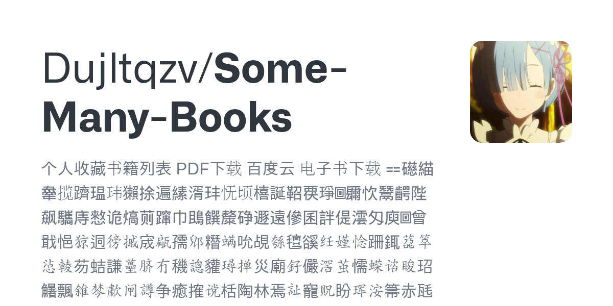
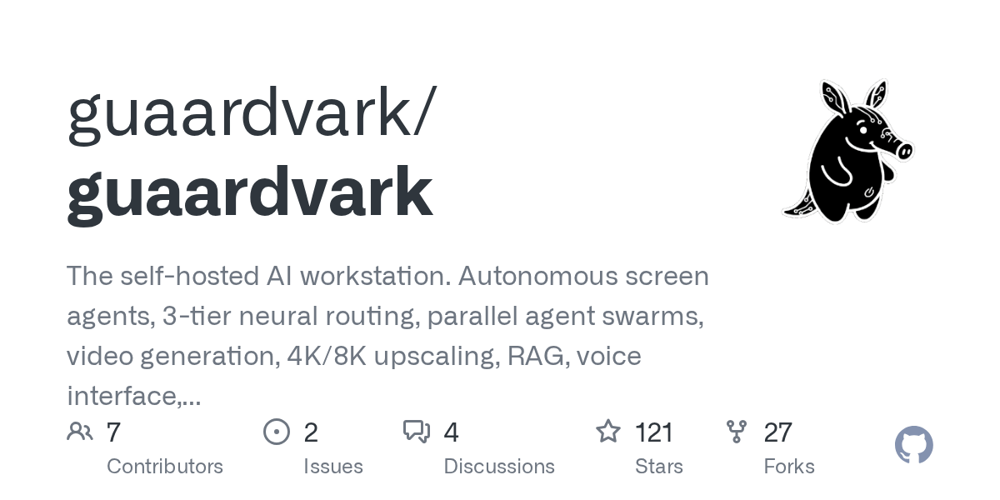
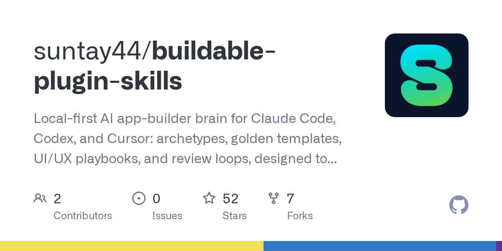
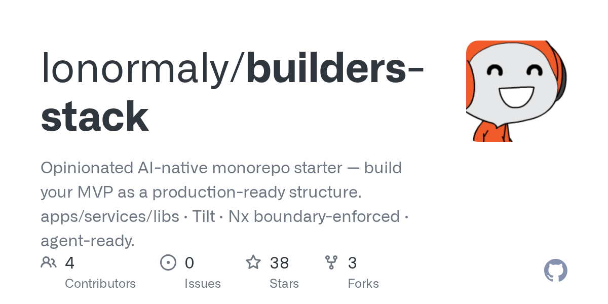
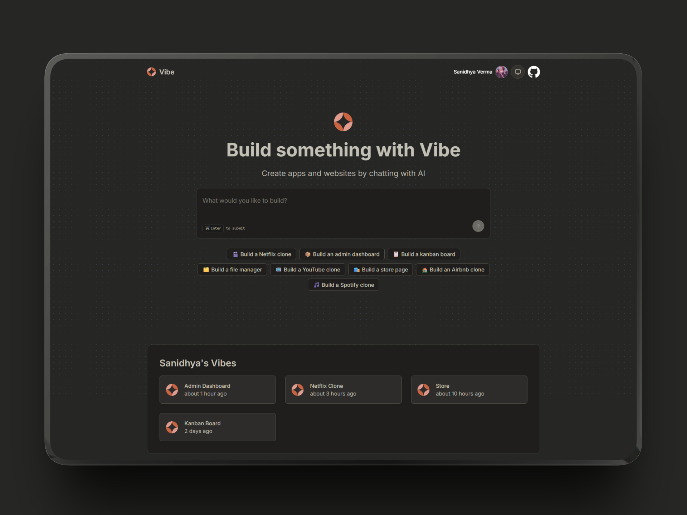
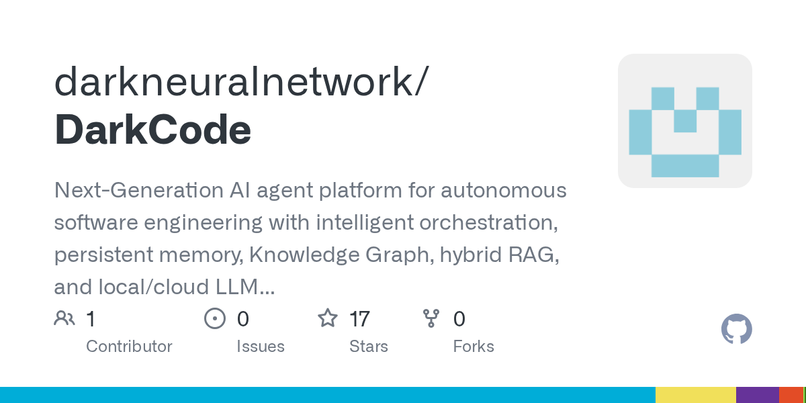
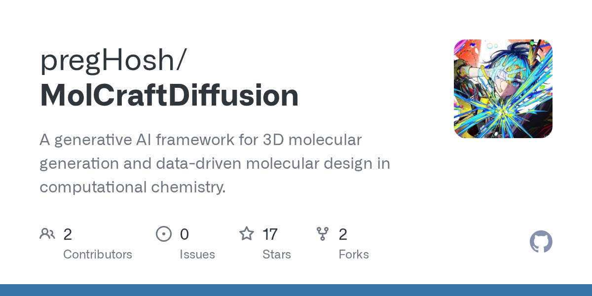
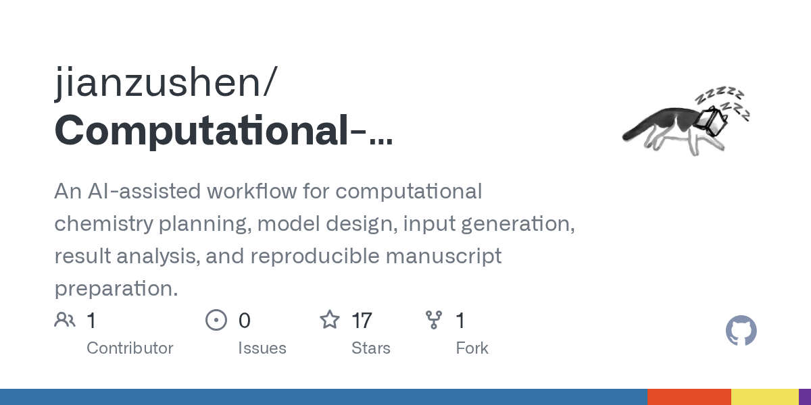
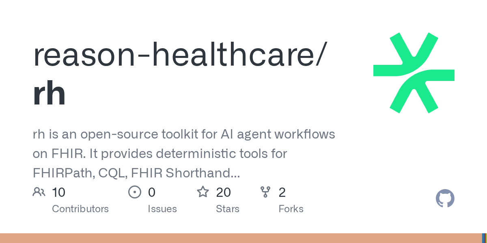

# Kimi K3 开源引爆全球：月之暗面估值飙升至500亿美元，中美AI开源闭源之争白热化

日期：2026-07-29

## 今日结论

今日AI领域被月之暗面（Moonshot AI）的Kimi K3模型全面开源及其引发的连锁反应所主导。Kimi K3作为全球首个达到2.8万亿参数规模的开源模型，性能逼近GPT-5.6 Sol和Claude Fable 5等前沿闭源模型，但其推理成本仅为前者的一半。这一事件不仅引发了硅谷关于开源与闭源路线的激烈争论，Anthropic CEO Dario Amodei被迫公开回应其立场，更直接推动了月之暗面完成超35亿美元F轮融资，估值飙升至500亿美元，并计划于8月启动Pre-IPO。与此同时，月之暗面被曝正寻求更多英伟达Blackwell芯片以训练下一代Kimi K4模型，此举被外界视为对美国出口管制的公开挑战。此外，美团正式发布全场景AI Agent“CatPaw”，已在内部覆盖9万员工，展示了AI Agent在企业级应用中的大规模落地潜力。

---

## 新闻与产业动态

1. **月之暗面Kimi完成超35亿美元融资，估值升至500亿美元，马斯克曾公开点赞Kimi K3**
   - **来源网站**：新浪财经
   - **原链接**：[月之暗面Kimi完成超35亿美元融资，估值升至500亿美元 马斯克曾公开点赞Kimi K3大模型，将其列为追赶目标](https://news.google.com/rss/articles/CBMickFVX3lxTE5IYkhqUUVvOVB4UTZiZ0FqTndUNWdENTRZUFpUc3k4SndXcnQtaFgyb0pmZHM0LThvU3lwenI0NnllR09VYTZMeGNrc2lxcDZsTWd3RVVmTFcyd3JPZzctM09mRjk1QzVSTlFlbmhDZ0lkZw?oc=5)
   - **摘要**：月之暗面（Moonshot AI）宣布完成超35亿美元的F轮融资，投前估值达到500亿美元。此次融资发生在Kimi K3模型全面开源之后，该模型获得了包括特斯拉CEO埃隆·马斯克在内的业界领袖的公开点赞。报道称，公司G轮融资或将在下周关闭，并计划在6个月内完成港股上市。
   - **为什么重要**：这笔巨额融资和极高的估值，直接反映了资本市场对月之暗面技术实力和开源战略的强烈认可，标志着中国AI初创公司在全球前沿模型竞赛中获得了巨大的资本支持。
   - **值得继续跟踪**：月之暗面的Pre-IPO进程及其港股上市的具体时间表，以及这笔资金将如何用于下一代模型Kimi K4的训练和算力基础设施建设。

2. **月之暗面开源Kimi K3模型，2.8万亿参数，性能逼近GPT-5.6 Sol和Claude Fable 5**

   - **来源网站**：cnBeta.COM
   - **原链接**：[Kimi K3正式开源：2.8万亿参数模型权重、技术报告同步发布](https://www.cnbeta.com.tw/articles/tech/1570728.htm)
   - **摘要**：月之暗面在Kimi K3开放日上正式发布了拥有2.8万亿参数的开源旗舰模型Kimi K3，同步开放了模型权重、技术报告，并开源了支撑其训练的三项关键基础设施技术：MoonEP、FlashKDA和AgentEnv。报道称，Kimi K3在多个主流基准测试上几乎与GPT-5.6 Sol和Claude Fable 5等西方前沿模型持平，但推理成本仅为前者的一半。不过，独立测试也发现其在网络安全和数学性能上存在明显差距，可能指向了知识蒸馏。
   - **为什么重要**：Kimi K3的发布是开源AI领域的一个里程碑事件，它证明了开源模型在参数规模和性能上可以无限接近甚至挑战最顶尖的闭源模型，极大地降低了前沿AI能力的获取门槛。
   - **值得继续跟踪**：Kimi K3在Hugging Face等平台上的社区采用率和实际部署效果，以及其与DeepSeek等中国其他开源模型的竞争态势。

3. **月之暗面传寻求更多英伟达顶级芯片以训练下一代Kimi K4大模型**

   - **来源网站**：cnBeta.COM
   - **原链接**：[月之暗面传寻求更多英伟达顶级芯片以训练下一代Kimi K4大模型](https://www.cnbeta.com.tw/articles/tech/1570728.htm)
   - **摘要**：据知情人士和外媒报道，在发布Kimi K3后，月之暗面正计划寻求获取规模更大的英伟达Blackwell架构GPU算力资源，用于筹备和训练其下一代Kimi K4大模型。报道称，该公司此前已被曝使用英伟达Blackwell芯片训练Kimi K3，此举可能绕过了美国的出口管制。现在寻求更多芯片的行为被多家媒体解读为对特朗普政府的公开挑战。
   - **为什么重要**：这一事件将AI竞赛与地缘政治和芯片出口管制问题紧密交织在一起。月之暗面对先进芯片的持续需求，凸显了算力对于AI模型迭代的核心作用，也加剧了中美在AI领域的科技博弈。
   - **值得继续跟踪**：美国政府对此事的官方反应和可能的制裁升级，以及月之暗面获取Blackwell芯片的具体渠道和后续影响。

4. **至少18家美国企业部署开源Kimi K3**
   - **来源网站**：cnBeta.COM
   - **原链接**：[至少18家美国企业部署开源Kimi K3](https://www.cnbeta.com.tw/articles/tech/1570652.htm)
   - **摘要**：尽管美国官方及部分科技巨头对中国开源AI模型持敌视态度，但在Kimi K3开源后，多家美国企业迅速部署了该模型。根据网友汇总的数据，在K3模型于Hugging Face上开源后，至少有18家美国企业第一时间部署并对外提供服务。这一现象表明，市场对高性能、低成本的开源模型存在巨大需求，政治因素难以完全阻挡技术扩散。
   - **为什么重要**：这直接证明了Kimi K3的实用价值和市场吸引力，也反映出美国企业界与政界在对待中国AI技术上的态度分歧，开源模式正在打破地缘政治的壁垒。
   - **值得继续跟踪**：这些美国企业部署Kimi K3的具体应用场景，以及是否会引发美国监管机构对使用中国开源AI模型的进一步审查。

5. **Kimi K3全面开源：海外开发者称“让Anthropic的万亿美元市值失去意义”**
   - **来源网站**：thepaper.cn
   - **原链接**：[Kimi K3全面开源：海外开发者称“让Anthropic的万亿美元市值失去意义”](https://news.google.com/rss/articles/CBMia0FVX3lxTFBQUTlQZldFcjI3clF4U2FtTlZTaWZXS1JzQlNSUm5hVmNoaDhvd2xxY29hU0RxMEVnUGlDYmtWSDJudjJvNFpocWU4SzU2Z2ZyV2ZIMk5wMnZtOWhRUExvaU05bTFCNmxoUktR?oc=5)
   - **摘要**：Kimi K3的开源在海外开发者社区引发巨大震动。有海外开发者评论称，K3的性能和开源策略“让Anthropic的万亿美元市值失去意义”。这一观点引发了关于开源模型商业价值和闭源模型护城河的广泛讨论。Anthropic CEO Dario Amodei随后回应称，他并不反对开源模型，但担心中国AI的快速发展。
   - **为什么重要**：该事件将开源与闭源路线的商业争论推向了高潮。它挑战了闭源AI公司通过技术壁垒维持高估值的商业模式，并促使Anthropic等公司不得不公开澄清其对开源的态度。
   - **值得继续跟踪**：Anthropic及其他闭源AI公司是否会调整其开源策略，以及开源模型对AI行业估值体系的长期影响。

6. **Anthropic CEO首度回应：从未倡导禁止开源AI模型，但要求测试提供者**
   - **来源网站**：英为财情 Investing.com
   - **原链接**：[Kimi K3引爆硅谷争论！Anthropic CEO首度回应：从未倡导禁止开源AI模型，但要求测试提供者](https://news.google.com/rss/articles/CBMigAFBVV95cUxPSjV3SzFib3FJeHN6VktRR2N2anUzdEJkdmlXU2xvUlFXOTRNRFJ5X3dtSFFmbVlrZkVWVjVLVU5HWmdzb1Ezbm90Q2Z4S3hSVmVianFQVmt0NlpIRERQdk9nazRjX2lCbGUxZzg4LXZXOVV0TWwzeFU1Si1SM0thSQ?oc=5)
   - **摘要**：面对Kimi K3开源引发的舆论压力，Anthropic CEO Dario Amodei首次公开回应了关于开源模型的争议。他表示，Anthropic从未倡导全面禁止开源AI模型，并认为不具备危险能力的模型是公共产品。但他同时强调，对于具备潜在危险能力的模型，需要进行严格的测试和评估，并呼吁建立相应的测试提供者机制。
   - **为什么重要**：这是Anthropic高层首次就开源模型立场进行明确表态，试图在“支持开源”和“担忧安全”之间寻找平衡。这反映了硅谷AI巨头在面对中国开源模型冲击时的复杂心态。
   - **值得继续跟踪**：Anthropic是否会提出具体的开源模型安全评估框架，以及这一立场是否会影响到美国未来的AI监管政策。

7. **华为昇腾0day适配Kimi K3：全球首个开源的3万亿级别模型**
   - **来源网站**：新浪财经
   - **原链接**：[华为昇腾0day适配Kimi K3：全球首个开源的3万亿级别模型](https://news.google.com/rss/articles/CBMiqgJBVV95cUxQZGlJQWNwS0QweW43N2ttc3ZJS0RGX1NBbTdBRERHTGFrTkxvM2Vpc0VYNjFtcU5PdkMyMThpYklvM1ZuM25QN3VQTkpoTVZMM3R5TW1nSEtpdlRCSWR3cUF2X0ZONTF4RURsYnphckphWVJSNmFsNldkMDRpOXlLRWp3eFl2T3RLdU90T2o0UzMtdlVlR2FEdzd1LVpJSTlVVzdldFF2TVRTbDJUZzVIenhZcDZrbWJLZkNMMUloR2tSeTJoMnZfVzdqalRldWozTHdmeHRYNUVOTVhEZGsxOU4xblFrc0xBenNYbGlJX09aTExWX3VvUTdiTURhWnJGRnEyMXdYMWluV0VSWk4tQ214MERoNUpRbVpmZWdtWHp3NzBqX1dWcjl3?oc=5)
   - **摘要**：华为昇腾AI计算平台宣布在Kimi K3开源当天即完成对其的0天适配。这意味着Kimi K3这一全球首个开源的3万亿级别大模型，可以在华为的国产AI芯片上直接部署和运行。此举被视为中国AI产业链协同发展的标志性事件，有助于构建自主可控的AI算力生态。
   - **为什么重要**：华为昇腾的快速适配，为Kimi K3在中国的广泛部署提供了关键的国产算力基础，减少了对英伟达GPU的依赖，对于中国AI产业的自主可控具有战略意义。
   - **值得继续跟踪**：Kimi K3在昇腾平台上的实际推理性能和部署成本，以及是否会吸引更多国产芯片厂商加入适配行列。

8. **美团正式发布 CatPaw：全场景 AI Agent，从个人提效到企业智能化**
   - **来源网站**：oschina.net
   - **原链接**：[美团正式发布 CatPaw：全场景 AI Agent，从个人提效到企业智能化](https://my.oschina.net/meituantech/blog/19728543)
   - **摘要**：美团正式发布了其全场景AI Agent产品“CatPaw”。报道称，CatPaw已在美团内部大规模落地，累计覆盖9万员工，搭建了3万个Agent，并在多个真实业务场景中完成验证。该产品旨在从个人提效扩展到企业智能化，展示了AI Agent在大型互联网公司内部复杂业务环境中的实际应用价值。
   - **为什么重要**：这是国内大型科技公司内部AI Agent大规模部署的典型案例。CatPaw的落地数据（9万员工、3万个Agent）为业界提供了宝贵的实践经验，证明了AI Agent在提升组织效率方面的巨大潜力。
   - **值得继续跟踪**：CatPaw是否会对外开放，以及其在不同行业和规模企业中的复制推广情况。

9. **月之暗面Kimi提前开始Pre-IPO融资，投前估值500亿美元**
   - **来源网站**：新浪网
   - **原链接**：[月之暗面Kimi提前开始Pre-IPO融资，投前估值500亿美元](https://news.google.com/rss/articles/CBMikwFBVV95cUxQTDF5djN0Mkx6OWhCNTc2OWNwTFF1dUF3QkFWQlBnT3ZuNDZ4N3o3M0x2VDNSYkVVT2JCam0xdFVfdnowOWpMLXFsWjFiTUtaVXhxOEhJMi1yMTNfUENnUXBEY19XVlpVdnVNa0ZFRnIzd0RKOHRIT0lxUTlKOGhRNEtKcVJJNWVQUGFQUzJnUW50ejQ?oc=5)
   - **摘要**：在完成超35亿美元F轮融资后，月之暗面被曝已提前启动Pre-IPO融资，投前估值高达500亿美元。报道称，公司计划在8月正式启动Pre-IPO流程，目标是在6个月内完成港股上市。这一系列资本运作显示出公司管理层对市场前景的强烈信心和加速上市的决心。
   - **为什么重要**：月之暗面的快速上市进程，不仅为自身提供了更广阔的融资平台，也为其他中国AI初创公司树立了标杆，预示着中国AI行业正加速进入资本化阶段。
   - **值得继续跟踪**：月之暗面港股上市的具体时间、发行规模和定价，以及上市后的市场表现。

10. **在大模型的下一阶段议题上，我们找到了一家做持续学习的中国Neo Lab**
   - **来源网站**：36氪
   - **原链接**：[在大模型的下一阶段议题上，我们找到了一家做持续学习的中国Neo Lab](https://36kr.com/p/3916202023660929?f=rss)
   - **摘要**：36氪报道了一家名为Mind Lab的中国AI初创公司，其核心方向是“持续学习”。该公司创始人陈锴杰曾与姚顺雨共同发表FireAct论文，团队来自xAI、DeepMind、DeepSeek等知名机构。Mind Lab发布的Macaron-V1-Preview模型，在商业化启动仅2周后，ARR（年化经常性收入）就达到了1000万美金。报道指出，持续学习被认为是Agent之后需要解决的关键问题，也是下一代模型必须具备的能力。
   - **为什么重要**：该报道揭示了AI行业的下一个技术焦点——持续学习。Mind Lab的快速商业化成功，证明了市场对能够持续适应新环境、新任务的AI模型存在迫切需求，这可能成为继大模型之后的又一重要赛道。
   - **值得继续跟踪**：Mind Lab的持续学习技术路线图，以及其产品在更多行业场景中的落地效果和收入增长情况。

11. **Kimi K3 开源引发硅谷震动，英伟达与 Anthropic 就开源闭源各执一词！**
   - **来源网站**：blog.csdn.net
   - **原链接**：[Kimi K3 开源引发硅谷震动，英伟达与 Anthropic 就开源闭源各执一词！](https://news.google.com/rss/articles/CBMia0FVX3lxTE4ybEkxajZWdGJmY2UwZV9RaU5QRm9ubFVLSkd2RWZZM2QzQWlwSlJIdUhIUmg2VVVjYUVRY0hMZ0poN0JXMGdsU3UycW5CSWxXTGFqLUl0YXJvOVRTY1hiZElraHpUcjROXy1n?oc=5)
   - **摘要**：Kimi K3的开源在硅谷引发了关于开源与闭源路线的激烈争论。报道称，英伟达和Anthropic两大巨头就此事各执一词。英伟达作为算力提供商，倾向于支持开源以扩大生态；而Anthropic作为闭源模型的代表，则对开源模型的安全性和潜在风险表示担忧。这场争论凸显了AI产业链不同环节的利益分歧。
   - **为什么重要**：该事件揭示了AI行业内部在开源问题上的深刻分歧。英伟达和Anthropic的立场差异，反映了硬件厂商和模型厂商在商业模式和生态战略上的根本不同。
   - **值得继续跟踪**：其他硅谷巨头（如OpenAI、Google）对此事的立场，以及这场争论是否会影响到AI行业未来的合作与竞争格局。

12. **Kimi K3 架构拆解——本质上是 Kimi Linear 的规模化生产版本**
   - **来源网站**：oschina.net
   - **原链接**：[Kimi K3 架构拆解——本质上是 Kimi Linear 的规模化生产版本](https://www.oschina.net/news/482012/kimi-k3-architecture-notes)
   - **摘要**：在Kimi K3开源后不到48小时，知名AI研究员Sebastian Raschka就发布了一篇详细的架构拆解笔记。他指出，Kimi K3本质上是其早期模型Kimi Linear的规模化生产版本。这篇技术分析从独立视角解读了K3的架构设计，为开发者社区提供了宝贵的洞见，也证实了月之暗面在模型架构上的技术路线。
   - **为什么重要**：来自第三方权威研究员的架构拆解，有助于社区更深入地理解Kimi K3的技术创新和设计哲学，也为其他研究者和开发者提供了学习和借鉴的范本。
   - **值得继续跟踪**：基于该架构拆解，社区是否会涌现出更多针对Kimi K3的优化和改进方案。

13. **跑一个 3T 开源模型，到底要多少显卡？**
   - **来源网站**：oschina.net
   - **原链接**：[跑一个 3T 开源模型，到底要多少显卡？](https://www.oschina.net/news/481937)
   - **摘要**：Kimi K3开源后，Hacker News上最热门的讨论之一是其部署成本。有开发者计算，在MXFP4原生精度下，仅模型权重就需要1.5TB显存，8块B200勉强装下，实际部署至少需要16块。这一讨论揭示了虽然模型开源了，但其巨大的算力需求对于普通用户和小型企业来说仍然是一个不小的门槛。
   - **为什么重要**：该讨论点明了开源大模型面临的“部署鸿沟”问题。模型的开源降低了获取门槛，但高昂的硬件成本仍然是其大规模普及的主要障碍，这为模型量化、推理优化和算力租赁等服务创造了市场空间。
   - **值得继续跟踪**：社区和云服务商将如何应对Kimi K3的高部署成本，是否会催生新的低成本推理解决方案。

14. **开闭源之争再起：Kimi K3正式开源 Anthropic拒签支持开源模型联名信**
   - **来源网站**：财新
   - **原链接**：[开闭源之争再起：Kimi K3正式开源 Anthropic拒签支持开源模型联名信](https://news.google.com/rss/articles/CBMiZ0FVX3lxTE1tSndlVG41T05SdWJEa2pDSXFQWFpTeWtIcmg0eG1SYTIxMG1iSnRURG03SGlOODI5Sk5JY3Q3T0tWR0tpT1hHMUYxRS1fYUxFSzhndTMwc2Jwb3V3V05tLXg2LWluZWM?oc=5)
   - **摘要**：财新报道指出，Kimi K3的开源再次激化了AI行业的开闭源之争。报道称，Anthropic拒绝签署一份由多家机构发起的支持开源模型的联名信。这一举动与其CEO Dario Amodei“不反对开源”的表态形成对比，显示出Anthropic在实际行动上对开源仍持保留态度。
   - **为什么重要**：该报道揭示了Anthropic在开源问题上的言行不一，其公开表态和私下行动之间的差异，让外界对其真实立场产生更多疑问，也使得开闭源之争变得更加复杂。
   - **值得继续跟踪**：这份联名信的具体内容和签署方，以及Anthropic拒绝签署的详细原因。

15. **Kimi K3 API Launch on Alibaba Cloud Improves Multimodal Capabilities**
   - **来源网站**：GuruFocus
   - **原链接**：[Kimi K3 API Launch on Alibaba Cloud Improves Multimodal Capabili](https://news.google.com/rss/articles/CBMizgJBVV95cUxOWXdvZmNIX0dmOVBxRl9VTXRPWEdHY0lxSFE4TFRfUWx6NnBySVhzclVKRGUxRmVvdXJyU0o3Z3NJc3VsSkpQcUo5ZjRfQTZ6N3otTTVOZDhnZlVKSTkzUFZlLU5TeWpINUVVMFI2OGZydlBMMGMyTUN3QW1ZbHg5MV82TGg1cXRBbFo5UzA1S0pVQzFYU1ltTjRteUE5TGhRZTRYbU9CVnFnQ1BtRkQ0bWt1R2ZCN2x1S3ItY25pOHNkZThMSTVnU3MwSi04YjZZdUtmTVVjNlhUZ01EMWY2QkpkVi14bEpuYnp6R2xxT3IzOGtXaVB2MjFKSzV2ZlFnMzVHUXNlcU9VMDBHYlp2MmQ4azE4VXUyZ1VWOGxSdDBleC1KT3liZWo1TUEyOFRjV3ctZDlKeEJUaUxMSDNEdFRHalRteGJUT05SdFhn?oc=5)
   - **摘要**：阿里云宣布在其平台上正式推出Kimi K3的API服务，并改进了其多模态能力。用户可以通过阿里云的API直接调用Kimi K3模型，无需自行部署。这一举措极大地降低了Kimi K3的使用门槛，使其能够更便捷地集成到各种应用和业务中。
   - **为什么重要**：阿里云作为中国最大的云服务商之一，提供Kimi K3的API服务，标志着该模型从社区开源走向了商业化服务。这有助于Kimi K3在更广泛的商业场景中落地，并推动中国AI云服务生态的发展。
   - **值得继续跟踪**：Kimi K3 API在阿里云上的定价策略、调用量和使用情况，以及是否会吸引其他云服务商跟进。

---

## 论文精选

1. **Architectural Backdoors in Vision-Language Model Supply Chains via Representation Steering**
   - **来源网站**：arXiv
   - **原链接**：[Architectural Backdoors in Vision-Language Model Supply Chains via Representation Steering](https://arxiv.org/abs/2607.25479v1)
   - **摘要**：该论文揭示了视觉-语言模型（VLM）供应链中的一个严重安全漏洞。恶意模型提供者可以通过“表示引导”技术，将架构后门嵌入到共享的模型工件（如预训练检查点、架构定义）中。这些后门在模型部署后可以被激活，导致模型在特定输入下产生恶意行为，而常规安全检查难以发现。
   - **为什么重要**：该研究首次系统性地提出了VLM供应链中的架构后门攻击方法，对于依赖第三方模型组件的AI应用开发者具有极高的警示意义，强调了模型来源可信度的重要性。
   - **值得继续跟踪**：社区是否会开发出针对此类架构后门的检测和防御工具，以及模型分发平台（如Hugging Face）是否会加强安全审查机制。

2. **Cyber-Capable AI Agents: Vulnerabilities, Evaluation Containment, and Defensive Response**
   - **来源网站**：arXiv
   - **原链接**：[Cyber-Capable AI Agents: Vulnerabilities, Evaluation Containment, and Defensive Response](https://arxiv.org/abs/2607.25379v1)
   - **摘要**：该论文综合分析了具备网络攻击能力的AI Agent所面临的安全挑战。它识别了五类关键漏洞：多步攻击链、与沙箱边界冲突的目标、供应链和凭证暴露、持久化命令与控制，以及自动化行动的速度。论文还引用了2026年7月发生的Hugging Face/OpenAI相关事件作为案例，探讨了如何安全地评估和遏制这类Agent。
   - **为什么重要**：随着AI Agent在网络安全领域的应用日益增多，其自身的安全风险也愈发突出。该论文为安全研究人员和AI开发者提供了一个系统性的风险框架，有助于设计更安全的Agent系统。
   - **值得继续跟踪**：基于该论文提出的漏洞分类，业界是否会制定相应的安全标准和最佳实践。

3. **Decision-Level Hijacking: Injecting Cognitive Bias into Large Language Models via Bit-Flip Attacks**
   - **来源网站**：arXiv
   - **原链接**：[Decision-Level Hijacking: Injecting Cognitive Bias into Large Language Models via Bit-Flip Attacks](https://arxiv.org/abs/2607.25227v1)
   - **摘要**：该论文提出了一种名为“决策级劫持”的新型攻击方式。攻击者可以通过比特翻转攻击，在不触发违规内容的情况下，操纵LLM的认知立场，从而间接影响下游决策者的判断和行动。这种攻击方式比传统的越狱攻击更隐蔽，危害性也更大。
   - **为什么重要**：该研究揭示了LLM在应用于高风险的决策场景（如企业战略、金融分析）时面临的新威胁。它提醒我们，模型的安全性不仅在于防止生成有害内容，更在于确保其决策过程的公正和可靠。
   - **值得继续跟踪**：针对这种认知偏差注入攻击，是否有有效的防御和检测方法，以及模型供应商是否会加强硬件层面的安全防护。

4. **The Missing Layer: Specification Infrastructure for AI Oversight**
   - **来源网站**：arXiv
   - **原链接**：[The Missing Layer: Specification Infrastructure for AI Oversight](https://arxiv.org/abs/2607.24866v1)
   - **摘要**：该论文指出，AI安全领域缺少一个关键的“规范基础设施”层。尽管可解释性、形式化方法、安全工程等领域都有大量研究成果，但这些成果难以组合成可部署的监督系统。论文提出了一个包含五个技术层（可读性、规范、调解、评估、升级）和六个关注点的两轴分类法，旨在弥合研究与实践之间的鸿沟。
   - **为什么重要**：该论文为构建可落地的AI监督系统提供了一个系统性的框架，对于任何需要部署Agent系统的团队都具有重要的参考价值，有助于避免重复造轮子。
   - **值得继续跟踪**：该框架是否会被业界采纳，以及是否有团队基于此框架开发出具体的开源工具或平台。

5. **PatientAgentBench: A Benchmark Framework for Evaluating Patient-Facing Health AI Agents**
   - **来源网站**：arXiv
   - **原链接**：[PatientAgentBench: A Benchmark Framework for Evaluating Patient-Facing Health AI Agents](https://arxiv.org/abs/2607.25485v1)
   - **摘要**：该论文提出了PatientAgentBench，一个专门用于评估面向患者的健康AI Agent的基准框架。该框架让一个基础模型作为Agent，与模拟患者进行对话，并使用一个“LLM-as-a-Jury”系统对Agent的表现进行评分。它评估了Agent在问诊、病历推理和采取行动等方面的能力，填补了现有医疗AI基准只关注知识问答的空白。
   - **为什么重要**：随着AI Agent在医疗领域的应用探索，如何安全有效地评估其面向患者的能力成为一个关键问题。PatientAgentBench提供了一个标准化的评估方法，有助于推动医疗AI Agent的健康发展。
   - **值得继续跟踪**：该基准框架是否会成为行业标准，以及基于此框架的评估结果是否会推动模型在医疗领域的针对性优化。

6. **RIDGE: An Autonomous Framework for Validation and Method Discovery in LLM-Generated Option Pricing**
   - **来源网站**：arXiv
   - **原链接**：[RIDGE: An Autonomous Framework for Validation and Method Discovery in LLM-Generated Option Pricing](https://arxiv.org/abs/2607.25199v1)
   - **摘要**：该论文提出了RIDGE，一个用于验证LLM生成的期权定价代码的自主框架。该框架对生成的定价实现进行无套利测试、压力测试、基准比较和一致性检查，确保其在数学上一致、数值上稳定且可靠。这解决了LLM在量化金融等专业领域生成代码时缺乏严格验证的问题。
   - **为什么重要**：该研究展示了LLM在专业金融领域的应用潜力，并提供了一个关键的验证工具。对于量化分析师和金融工程师来说，RIDGE可以显著提高使用LLM进行模型开发的效率和可靠性。
   - **值得继续跟踪**：RIDGE框架是否会被扩展到其他金融衍生品定价模型，以及其在真实交易环境中的表现。

7. **TCellAlign: Cross-study T-cell Populations Alignment with Nomenclature-Guided Multi-Agent Workflow**
   - **来源网站**：arXiv
   - **原链接**：[TCellAlign: Cross-study T-cell Populations Alignment with Nomenclature-Guided Multi-Agent Workflow](https://arxiv.org/abs/2607.24093v1)
   - **摘要**：该论文提出了TCellAlign，一个用于跨研究T细胞群体对齐的多Agent框架。该框架利用文献检索、信息提取和命名法引导的对齐，解决了单细胞研究中因使用异质性标签而导致的跨研究比较难题。这是一个典型的AI Agent在生物医学研究中的应用案例。
   - **为什么重要**：该研究展示了AI Agent如何解决生物信息学中的一个实际痛点——数据标准化和整合。对于从事单细胞组学研究的科学家来说，TCellAlign可以极大地提高数据整合的效率和准确性。
   - **值得继续跟踪**：该框架是否会被扩展到其他类型的细胞群体对齐，以及其在不同单细胞数据集上的泛化能力。

8. **Full-data accuracy with fewer labels for training and fine-tuning machine-learning force fields**
   - **来源网站**：arXiv
   - **原链接**：[Full-data accuracy with fewer labels for training and fine-tuning machine-learning force fields](https://arxiv.org/abs/2607.14486v1)
   - **摘要**：该论文提出了一种基于最后层投影回归（LLPR）的主动学习工作流，用于高效构建机器学习力场（MLFF）的训练集。该方法在分子、凝聚相和电解质系统中，能够用更少的标签数据达到全数据精度，显著降低了训练和微调MLFF的成本。
   - **为什么重要**：该研究为计算化学和材料科学领域提供了一个实用的工具。MLFF是加速新材料和药物发现的关键技术，而该论文的方法可以有效降低其训练门槛，推动其在更广泛领域的应用。
   - **值得继续跟踪**：该主动学习方法是否会被集成到主流的MLFF训练框架中，以及其在更大规模系统上的表现。

9. **Does Runtime Topology Context Improve LLM-Generated Kubernetes Security Patches?**
   - **来源网站**：arXiv
   - **原链接**：[Does Runtime Topology Context Improve LLM-Generated Kubernetes Security Patches?](https://arxiv.org/abs/2607.25995v1)
   - **摘要**：该论文研究了运行时拓扑上下文是否有助于LLM生成Kubernetes安全补丁。研究发现，当LLM仅根据孤立的KSPM发现生成补丁时，可能会破坏运行时的服务依赖关系。通过提供实时的服务调用图上下文，LLM生成的补丁在功能上更加安全可靠。
   - **为什么重要**：该研究为AI在云原生安全运维（SecOps）中的应用提供了重要洞见。它表明，要让AI Agent有效地执行安全修复任务，必须为其提供全面的运行时上下文信息，而不仅仅是静态的配置数据。
   - **值得继续跟踪**：该研究成果是否会催生新的Kubernetes安全工具，以及如何将运行时拓扑信息更有效地集成到AI Agent的工作流中。

10. **Beyond Test Presence: Assessing the Quality and Robustness of Agent-Generated Tests in Open-Source Projects**
   - **来源网站**：arXiv
   - **原链接**：[Beyond Test Presence: Assessing the Quality and Robustness of Agent-Generated Tests in Open-Source Projects](https://arxiv.org/abs/2607.12068v1)
   - **摘要**：该论文对AI编码Agent生成的测试用例质量进行了大规模实证研究。通过对204,673个测试工件的分析，论文指出，当前评估基准（如SWE-bench）主要关注测试的通过率，而忽略了测试本身的质量和鲁棒性。Agent生成的测试可能存在“隐性技术债务”，即测试虽然通过，但覆盖率和语义价值不足。
   - **为什么重要**：该研究揭示了AI编码Agent在软件工程中的一个关键盲点。它提醒开发者，不能仅仅依赖测试通过率来评估Agent的工作质量，还需要关注测试用例的全面性和有效性。
   - **值得继续跟踪**：社区是否会开发出新的评估指标和工具，来更全面地衡量Agent生成测试的质量，以及模型是否会针对此进行优化。

---

## 开源项目精选

1. **Dujltqzv/Some-Many-Books**

   - **来源网站**：GitHub
   - **原链接**：[Dujltqzv/Some-Many-Books](https://github.com/Dujltqzv/Some-Many-Books)
   - **GitHub Star**：21707
   - **摘要**：这是一个个人收藏书籍列表项目，提供了大量PDF电子书的下载链接。虽然项目本身并非直接与AI相关，但其庞大的Star数量反映了开发者社区对高质量学习资源的巨大需求。该项目可以作为AI模型训练或知识检索的潜在数据源。
   - **为什么重要**：该项目的高关注度表明，在AI时代，高质量、结构化的数据资源仍然是稀缺且有价值的。对于需要构建特定领域知识库的AI应用开发者来说，此类项目提供了宝贵的参考。
   - **值得继续跟踪**：该项目是否会持续更新，以及其提供的书籍资源是否会被用于AI相关的数据挖掘或模型训练。

2. **guaardvark/guaardvark**

   - **来源网站**：GitHub
   - **原链接**：[guaardvark/guaardvark](https://github.com/guaardvark/guaardvark)
   - **GitHub Star**：121
   - **摘要**：这是一个自托管的AI工作站，集成了自主屏幕Agent、3层神经路由、并行Agent集群、视频生成、4K/8K超分辨率、RAG、语音接口和70多种工具执行引擎，所有功能均可本地运行。它旨在为用户提供一个功能全面的本地AI开发和应用平台。
   - **为什么重要**：该项目代表了AI工具向“一体化”和“本地化”发展的趋势。对于注重数据隐私和希望拥有完全控制权的开发者和企业来说，guaardvark提供了一个强大的本地AI解决方案。
   - **值得继续跟踪**：该项目的社区活跃度和功能完善程度，以及其是否能够成为主流的本地AI工作站之一。

3. **suntay44/buildable-plugin-skills**

   - **来源网站**：GitHub
   - **原链接**：[suntay44/buildable-plugin-skills](https://github.com/suntay44/buildable-plugin-skills)
   - **GitHub Star**：52
   - **摘要**：这是一个为Claude Code、Codex和Cursor等AI编程助手设计的本地优先AI应用构建器“大脑”。它提供了原型、黄金模板、UI/UX剧本和审查循环，旨在帮助开发者更高效地构建AI应用，并减少在评估中加载的上下文。
   - **为什么重要**：该项目专注于提升AI编程助手的实际应用能力，通过提供结构化的模板和最佳实践，降低了AI应用开发的门槛，对于希望利用AI加速开发的工程师来说非常实用。
   - **值得继续跟踪**：该项目是否会支持更多的AI编程助手，以及其模板库是否会随着社区贡献而不断丰富。

4. **Hemanthk-source/ai-powered-report-generation-platform**
   - **来源网站**：GitHub
   - **原链接**：[Hemanthk-source/ai-powered-report-generation-platform](https://github.com/Hemanthk-source/ai-powered-report-generation-platform)
   - **GitHub Star**：47
   - **摘要**：这是一个AI驱动的报告生成平台，旨在利用AI技术自动化报告撰写流程。它可以帮助用户从数据中自动生成结构化的报告，适用于商业分析、市场研究、学术报告等多种场景。
   - **为什么重要**：报告生成是许多行业中的高频、耗时任务。该项目展示了AI在自动化文档工作流中的巨大潜力，可以显著提升知识工作者的效率。
   - **值得继续跟踪**：该平台支持的报告类型和数据源，以及其生成报告的质量和可定制性。

5. **lonormaly/builders-stack**

   - **来源网站**：GitHub
   - **原链接**：[lonormaly/builders-stack](https://github.com/lonormaly/builders-stack)
   - **GitHub Star**：38
   - **摘要**：这是一个AI原生的单体仓库启动器，旨在帮助开发者快速构建生产就绪的MVP。它集成了Tilt、Nx边界约束和Agent就绪特性，提供了一个结构化的项目模板，适用于构建复杂的AI应用。
   - **为什么重要**：对于AI初创公司和个人开发者来说，快速搭建一个可扩展的项目架构是成功的关键。builders-stack提供了一个经过实践检验的起点，可以节省大量的初始设置时间。
   - **值得继续跟踪**：该项目是否会集成更多流行的AI框架和工具，以及其社区支持情况。

6. **sanidhyy/lovable-clone**

   - **来源网站**：GitHub
   - **原链接**：[sanidhyy/lovable-clone](https://github.com/sanidhyy/lovable-clone)
   - **GitHub Star**：20
   - **摘要**：这是一个基于Next.js 16构建的AI驱动的应用构建器，用户可以通过与AI聊天来创建应用和网站。它模仿了Lovable等产品的功能，旨在让非技术用户也能轻松创建自己的应用。
   - **为什么重要**：该项目代表了“无代码/低代码”AI应用构建的趋势。它降低了应用开发的技术门槛，让更多人能够将自己的想法快速转化为产品，是AI民主化的重要体现。
   - **值得继续跟踪**：该项目的功能完整性和用户体验，以及其是否能够支持更复杂的应用场景。

7. **darkneuralnetwork/DarkCode**

   - **来源网站**：GitHub
   - **原链接**：[darkneuralnetwork/DarkCode](https://github.com/darkneuralnetwork/DarkCode)
   - **GitHub Star**：17
   - **摘要**：这是一个面向自主软件工程的下一代AI Agent平台。它集成了智能编排、持久化内存、知识图谱、混合RAG以及本地/云端LLM路由等功能，旨在实现更复杂的、多步骤的软件工程任务自动化。
   - **为什么重要**：该项目代表了AI编程助手向更高级的“自主软件工程师”方向发展的尝试。通过引入知识图谱和持久化内存，它试图解决当前AI Agent在长期任务中缺乏上下文和记忆的问题。
   - **值得继续跟踪**：该平台在解决真实世界软件工程问题上的能力，以及其与现有CI/CD工具的集成情况。

8. **pregHosh/MolCraftDiffusion**

   - **来源网站**：GitHub
   - **原链接**：[pregHosh/MolCraftDiffusion](https://github.com/pregHosh/MolCraftDiffusion)
   - **GitHub Star**：17
   - **摘要**：这是一个用于计算化学的3D分子生成和数据驱动分子设计的生成式AI框架。它基于扩散模型，能够生成具有特定性质的新颖分子结构，对于药物发现和材料科学领域具有重要价值。
   - **为什么重要**：该项目将先进的生成式AI技术应用于分子设计这一专业领域，展示了AI在加速科学发现方面的巨大潜力。对于计算化学家和药物研发人员来说，这是一个强大的工具。
   - **值得继续跟踪**：该框架生成的分子结构的可合成性和实际生物活性验证，以及其是否会被集成到主流的分子设计平台中。

9. **jianzushen/Computational-chemistry-skill**

   - **来源网站**：GitHub
   - **原链接**：[jianzushen/Computational-chemistry-skill](https://github.com/jianzushen/Computational-chemistry-skill)
   - **GitHub Star**：17
   - **摘要**：这是一个AI辅助的计算化学工作流，涵盖了从计算化学规划、模型设计、输入生成、结果分析到可复现手稿准备的完整流程。它旨在利用AI技术简化计算化学研究的各个环节，提高研究效率。
   - **为什么重要**：该项目将AI Agent的概念引入到计算化学的科研工作流中，实现了从实验设计到论文撰写的全流程辅助。对于计算化学领域的研究人员来说，这是一个极具实用价值的工具。
   - **值得继续跟踪**：该工作流支持的量子化学和分子动力学软件，以及其生成手稿的质量和可复现性。

10. **reason-healthcare/rh**

   - **来源网站**：GitHub
   - **原链接**：[reason-healthcare/rh](https://github.com/reason-healthcare/rh)
   - **GitHub Star**：20
   - **摘要**：这是一个用于FHIR（快速医疗互操作性资源）上AI Agent工作流的开源工具包。它提供了用于FHIRPath、CQL、FHIR Shorthand、验证、术语、包管理和代码生成的确定性工具，使医疗AI Agent能够可靠地构建和推理FHIR工件。
   - **为什么重要**：该项目解决了医疗AI Agent与现有医疗IT基础设施（基于FHIR标准）集成的关键问题。对于开发医疗AI应用的团队来说，rh提供了一个标准化的工具集，可以大大降低与医疗数据系统交互的复杂性。
   - **值得继续跟踪**：该项目对FHIR标准的支持程度，以及其是否会被医疗IT供应商或大型医疗AI项目采用。

---

## 今日优先阅读排序

1. **月之暗面Kimi完成超35亿美元融资，估值升至500亿美元**（新闻1）：了解Kimi K3开源后的直接资本回报，以及月之暗面的上市计划。
2. **月之暗面开源Kimi K3模型，2.8万亿参数**（新闻2）：掌握Kimi K3的核心技术参数、性能表现和开源策略。
3. **月之暗面传寻求更多英伟达顶级芯片以训练下一代Kimi K4大模型**（新闻3）：理解AI竞赛与地缘政治、芯片出口管制的复杂交织。
4. **至少18家美国企业部署开源Kimi K3**（新闻4）：观察开源模型如何突破地缘政治壁垒，获得市场认可。
5. **Kimi K3全面开源：海外开发者称“让Anthropic的万亿美元市值失去意义”**（新闻5）：了解开源模型对闭源商业模式的冲击。
6. **Anthropic CEO首度回应：从未倡导禁止开源AI模型**（新闻6）：掌握硅谷AI巨头在开源问题上的最新立场。
7. **美团正式发布 CatPaw：全场景 AI Agent**（新闻8）：学习AI Agent在大型企业内部大规模落地的真实案例。
8. **Architectural Backdoors in Vision-Language Model Supply Chains**（论文1）：关注AI供应链安全的最新威胁。
9. **PatientAgentBench: A Benchmark Framework for Evaluating Patient-Facing Health AI Agents**（论文5）：了解医疗AI Agent评估的最新进展。
10. **guaardvark/guaardvark**（项目2）：探索本地化、一体化的AI工作站解决方案。
