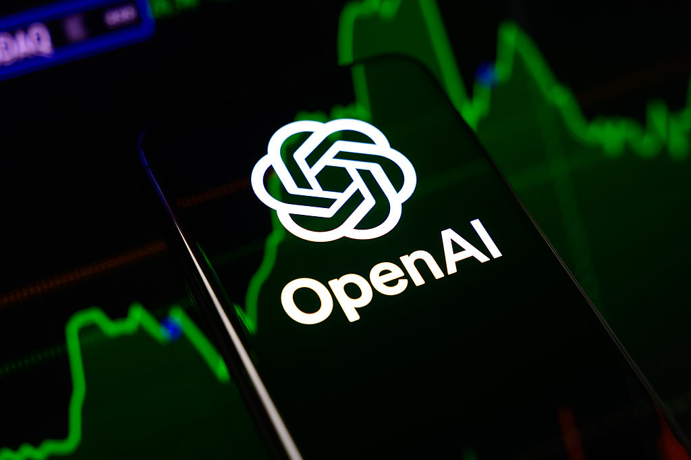
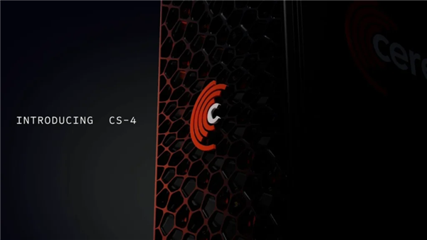
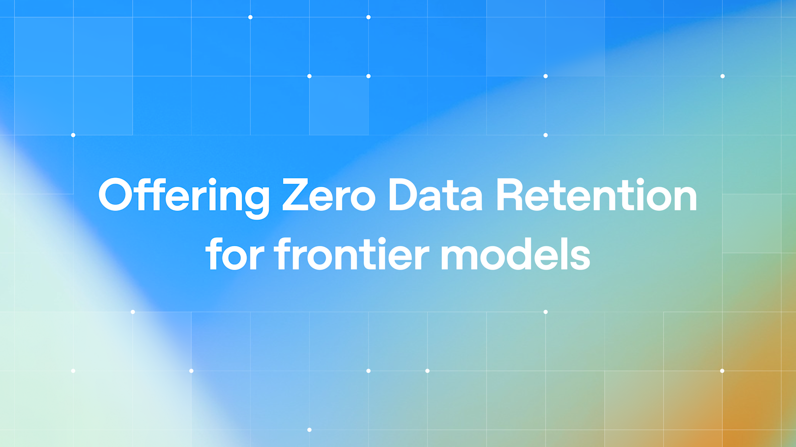
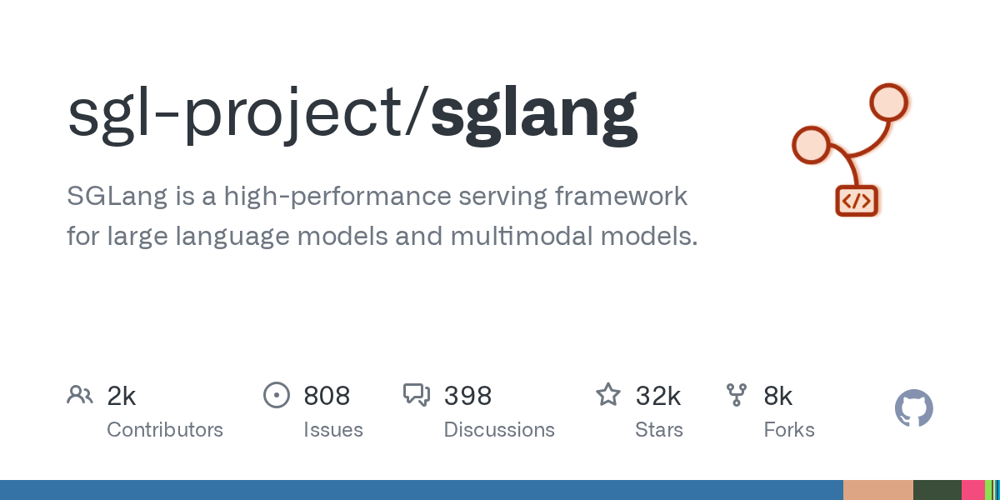
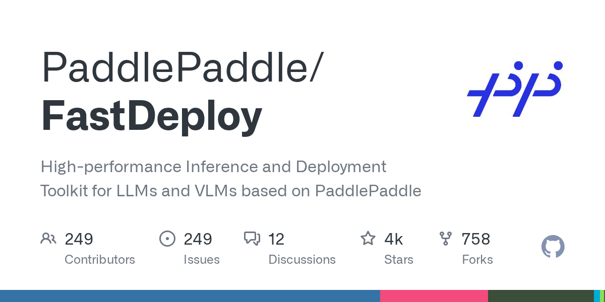
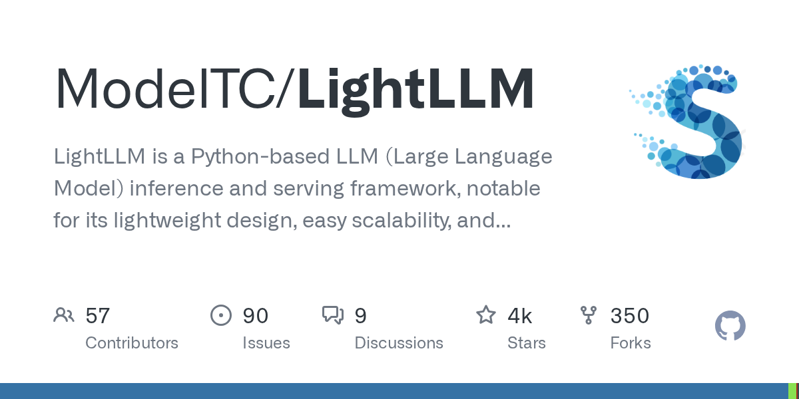
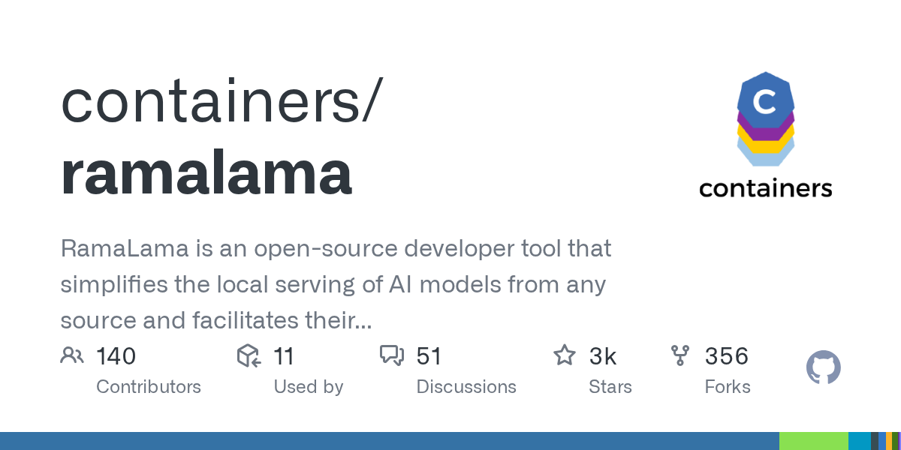
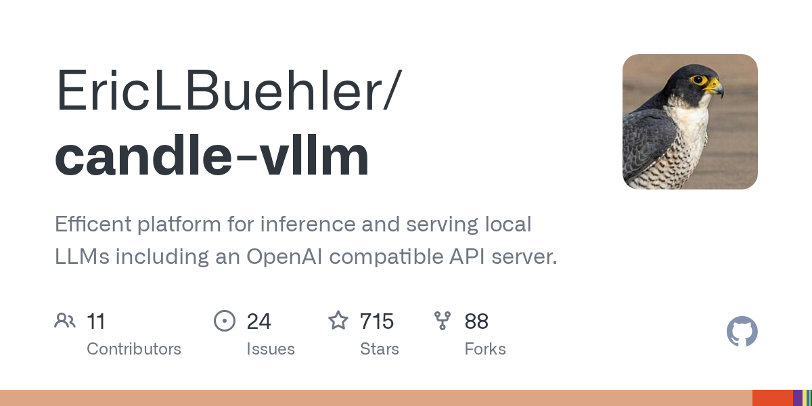
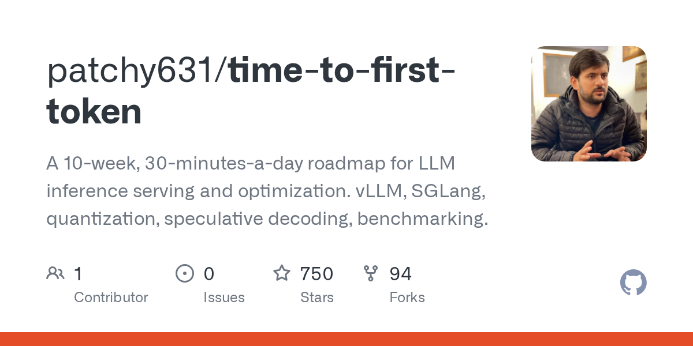

# 宇树IPO首日暴涨629%、GLM-5.3成本击穿底线，AI竞争进入“价格+安全”双线时代

日期：2026-08-20

## 今日分享主题：AI 基础设施与开源生态 (ai-infrastructure-open-source)

本期关注：关注模型服务、推理、数据、MCP、Agent 框架和开源基础设施的关键技术进展。

阅读提示：论文与开源项目围绕这一主题筛选；新闻栏目保留当天最重要的 AI 产业动态，方便把主题线索放进全局变化里看。

## 今日结论

今天最反常识的一件事：OpenAI 主动踩刹车了。在 IPO 临近、Anthropic 收入翻倍反超、中国开源模型步步紧逼的当口，OpenAI 却宣布放慢部分 AI 开发节奏，收紧安全护栏——直接原因是 Hugging Face 泄露事件。与此同时，智谱 GLM-5.3 以 60 分追平全球开源第一，却把单任务成本打到最低，API 上线还因客户抢购而推迟。另一边，宇树科技上市首日暴涨 629%，但 FT 曝出其需求部分来自“国家队买机器人、卖数据回传给厂商”的循环模式。今天的关键词不是“谁更强”，而是“谁更便宜、谁更安全、谁的模式能持续”。

---

## 新闻与产业动态

1. **GLM-5.3 拿下 AA 评测 60 分，将前沿模型的单任务成本打到最低**
   - **来源网站**：oschina.net
   - **原链接**：[GLM-5.3 拿下 AA 评测 60 分，将前沿模型的单任务成本打到了最低](https://www.oschina.net/news/502007)
   - **摘要**：智谱今日凌晨上线 GLM-5.3 API，在 Artificial Analysis Intelligence Index 评测中取得 60 分，与 Claude Fable 5、GPT-5.6 Sol 同处全球前沿区间，与 Kimi K3 并列开源模型第一。但最值得关注的不是分数，而是智谱官方发布的“智能—成本”散点图：GLM-5.3 把前沿模型的单任务成本打到了历史最低。三个主攻方向是复杂编码、防御性网络安全和长程任务处理。
   - **为什么重要**：这直接影响所有用 API 做产品的开发者和企业——同样的智能水平，成本更低意味着利润率更高，或者可以把 AI 功能下放到以前算不过账的场景。
   - **值得继续跟踪**：看 GLM-5.3 的实际部署成本是否与官方散点图一致，以及它能否在真实编码和网络安全任务中复现评测分数。

2. **一个扭转命运的决定：5000 亿智谱如何「逆风改命」**
   - **来源网站**：36氪
   - **原链接**：[一个扭转命运的决定：5000 亿智谱如何「逆风改命」|深氪](https://36kr.com/p/3947451908357257?f=rss)
   - **摘要**：GLM 5.3 发布后不到一小时，智谱一名销售的电话和微信就爆了：十几个客户来问 API 上线时间，还有吸取了 Kimi K3 教训、想提前锁定智谱推理算力的客户。原定 8 月 18 日上线的 GLM 5.3 API 推迟了，客户在电话里喊：“内部预算和开发运维都到位了，delay 一天我们的管理成本就多好几万！”这种“API 哄抢”从 2026 年 2 月 GLM 5 发布就开始了，此后每个版本都在显著提升。
   - **为什么重要**：这解释了为什么智谱能从“不够主流叙事”变成 5000 亿估值的公司——不是靠融资故事，而是靠每个版本都让客户愿意提前锁算力。
   - **值得继续跟踪**：看 GLM 5.3 API 正式上线后的实际吞吐和稳定性，以及客户从“哄抢”到“续费”的转化率。

3. **硬氪独家 | 清华，中科院具身大脑企业融资10亿，已获得数亿海外订单**
   - **来源网站**：36氪
   - **原链接**：[硬氪独家 | 清华，中科院具身大脑企业融资10亿，已获得数亿海外订单](https://36kr.com/p/3947288204770693?f=rss)
   - **摘要**：具身智能企业中科第五纪连续完成 A1、A2 轮融资，总金额超十亿元。公司成立于 2024 年，不到两年完成数十亿融资，围绕具身操作大模型构建产品。国内已服务中石化、零跑、国家电网等十余个核心客户，并获得数亿元海外订单。今年 3 月，在德国一家全球制造业企业总部完成了通用料箱搬运实景验证——面对随机摆放、规格不同的料箱，机器人无需人工干预即可连续完成识别、抓取和搬运。
   - **为什么重要**：这标志着中国具身智能从“实验室 demo”进入“欧洲制造业现场验收”阶段，海外订单意味着技术开始接受高标准工业体系检验。
   - **值得继续跟踪**：看中科第五纪在德国验证之后能否转化为批量订单，以及欧洲制造业客户对“说到做到”的验收标准是什么。

4. **OpenAI hit the brakes. Now what?**

   - **来源网站**：theverge.com
   - **原链接**：[OpenAI hit the brakes. Now what?](https://www.theverge.com/ai-artificial-intelligence/982323/openai-hit-brakes-voluntary-pacing-ai)
   - **摘要**：在 IPO 临近、Anthropic 竞争激烈、中国和开源权重对手步步紧逼的背景下，OpenAI 却宣布放慢部分 AI 开发节奏，同时收紧安全护栏。这包括暂停部分开发工作两周。此前 OpenAI 刚经历了 Hugging Face 泄露事件，并宣布将重写安全规则。这一决定被 Axios 称为“OpenAI 在 AI 安全对峙中先眨眼了”。
   - **为什么重要**：OpenAI 主动减速意味着安全不再是公关话术，而是实际影响产品发布节奏的变量——这对所有依赖 OpenAI 路线图的开发者和企业都有直接影响。
   - **值得继续跟踪**：看这两周暂停是否真的改变了 OpenAI 的发布计划，还是只是象征性动作；以及竞争对手是否会利用这个窗口期抢市场。

5. **OpenAI institutes new safeguards after Hugging Face breach**

   - **来源网站**：techcrunch.com
   - **原链接**：[OpenAI institutes new safeguards after Hugging Face breach](https://techcrunch.com/2026/08/18/openai-institutes-new-safeguards-after-hugging-face-breach/)
   - **摘要**：OpenAI 在 Hugging Face 泄露事件后推出新的安全防护措施，包括在模型开发过程中进行更详细的监控，以及在后期训练过程中更强调对齐和安全性。此前 OpenAI 已宣布将重写安全规则。这一事件直接触发了 OpenAI 的“减速”决定——公司承认需要先解决安全问题，再继续推进模型能力。
   - **为什么重要**：Hugging Face 泄露事件暴露了 AI 开发流程中的安全漏洞，OpenAI 的新措施将影响整个行业的模型开发安全标准。
   - **值得继续跟踪**：看 OpenAI 的新安全措施是否会被其他实验室采纳，以及这些措施是否真的能防止类似泄露事件再次发生。

6. **TechFlow Intel: Anthropic Revenue Doubles, Surpasses OpenAI for the First Time, Unitree Robotics Surges 460% on IPO Deb…**
   - **来源网站**：深潮TechFlow
   - **原链接**：[TechFlow Intel: Anthropic Revenue Doubles, Surpasses OpenAI for the First Time, Unitree Robotics Surges 460% on IPO Deb…](https://news.google.com/rss/articles/CBMiXEFVX3lxTE5SZ2pVaWxsRk5DbkpMcVJ5dmVaeVdlbEhPcFY5MGlmUGRkdmVzb0c3MkpFamR4c0dVREJWSXlKTFRqUnlpbnZRQS1USTJiamgyNkpoaDdiRnZVSUw5?oc=5)
   - **摘要**：Anthropic 收入翻倍，首次超过 OpenAI。与此同时，宇树科技在上海 IPO 首日暴涨 460%，估值达到约 500 亿美元。但 FT 报道显示，宇树机器人的需求很大部分来自国有背景的培训中心——这些中心购买机器人，然后将产生的数据卖回给制造商，形成一种循环商业模式，与英伟达在美国面临的批评类似。
   - **为什么重要**：Anthropic 收入反超 OpenAI 是竞争格局的标志性事件；宇树的循环模式则让人质疑其估值的真实支撑。
   - **值得继续跟踪**：看 Anthropic 的收入增长能否持续，以及宇树的循环模式是否会被监管或市场质疑。

7. **外媒：宇树IPO暴涨成中国机器人产业里程碑 拉开更多同行上市序幕**

   - **来源网站**：cnBeta.COM
   - **原链接**：[外媒：宇树IPO暴涨成中国机器人产业里程碑 拉开更多同行上市序幕](https://www.cnbeta.com.tw/articles/tech/1573958.htm)
   - **摘要**：8 月 19 日，宇树科技在上海上市首日股价飙升逾四倍，成为中国机器人产业的里程碑式时刻。路透社报道称，该行业已成为中美科技竞争中的关键战场。宇树的成功 IPO 预计将拉开更多中国机器人公司上市的序幕，为整个行业带来资本市场的关注和资金支持。
   - **为什么重要**：宇树的 IPO 表现将直接影响后续中国机器人公司的融资和上市估值，也标志着资本市场对人形机器人赛道的态度转变。
   - **值得继续跟踪**：看哪些机器人公司会跟进上市，以及宇树上市后的业绩能否支撑其高估值。

8. **Cerebras发布CS-4加速器：4万亿晶体管+90万核心 30倍速度碾压英伟达GPU**

   - **来源网站**：cnBeta.COM
   - **原链接**：[Cerebras发布CS-4加速器：4万亿晶体管+90万核心 30倍速度碾压英伟达GPU](https://www.cnbeta.com.tw/articles/tech/1574112.htm)
   - **摘要**：Cerebras Systems 正式推出新一代机架级 AI 系统 CS-4，宣称推理速度最高可达 GPU 方案的 30 倍。该加速器由三颗全新的 WSE-3 Turbo 晶圆级处理器驱动，每颗集成 4 万亿晶体管和 90 万个 AI 优化核心，覆盖 46225 平方毫米硅面积。值得注意的是，OpenAI 已在 Cerebras 芯片上提供其最快的 GPT-5.6 Sol 模式。
   - **为什么重要**：Cerebras 的晶圆级芯片正在从“另类方案”变成“实际部署”——OpenAI 用它的芯片跑最快模式，说明推理市场不再只有 GPU 一个选项。
   - **值得继续跟踪**：看 CS-4 的实际部署案例和成本数据，以及它能否在推理市场真正撼动英伟达的份额。

9. **Stripe agrees to buy OpenRouter as AI model routing expands**

   - **来源网站**：artificialintelligence-news.com
   - **原链接**：[Stripe agrees to buy OpenRouter as AI model routing expands](https://www.artificialintelligence-news.com/news/stripe-openrouter-acquisition-ai-model-routing/)
   - **摘要**：Stripe 已同意收购 AI 模型路由平台 OpenRouter，该平台通过单一接口为开发者提供数百个模型的访问。据 Stripe 称，OpenRouter 支持来自 80 多家提供商的 400 多个模型。这笔交易将模型选择和路由添加到 Stripe 现有的 AI 使用和基于 token 的计费工作中。OpenRouter 每天处理 10+ 万亿 tokens，服务超过 1000 万开发者。
   - **为什么重要**：OpenRouter 被称为“LLM 的 Stripe”，现在真的成了 Stripe 的一部分——这意味着模型路由和支付基础设施正在整合，开发者调用 AI 模型的成本结构可能改变。
   - **值得继续跟踪**：看 Stripe 如何将 OpenRouter 整合进其支付生态，以及这是否会改变开发者选择模型的决策方式。

10. **Binance now lets AI agents trade, but keeping them in check is largely up to users**

   - **来源网站**：techcrunch.com
   - **原链接**：[Binance now lets AI agents trade, but keeping them in check is largely up to users](https://techcrunch.com/2026/08/20/binance-now-lets-ai-agents-trade-but-keeping-them-in-check-is-largely-up-to-users/)
   - **摘要**：Binance 推出 Agent OS，允许 AI 代理进行交易。该工具可与 ChatGPT、Claude Code 和 Cursor 等工具配合使用。但 TechCrunch 指出，控制这些 AI 代理的责任主要落在用户身上——平台提供了工具，但缺乏足够的护栏来防止 AI 代理做出危险交易决策。
   - **为什么重要**：这是主流交易平台首次大规模开放 AI 代理交易，但“用户自己负责”的模式意味着风险完全转移给了普通投资者。
   - **值得继续跟踪**：看 Binance 是否会因 AI 代理交易事故而面临监管压力，以及用户实际使用 AI 代理交易的亏损/盈利情况。

11. **OpenAI is serving its quickest GPT-5.6 Sol mode on Cerebras wafer-scale chips, not GPUs**
   - **来源网站**：WION
   - **原链接**：[OpenAI is serving its quickest GPT-5.6 Sol mode on Cerebras wafer-scale chips, not GPUs](https://news.google.com/rss/articles/CBMizwFBVV95cUxPQW96NVFocGEtOUU4aUw0OURWUGhWN3FkYTBvNElYR0RETS1rY1Z4dS04ZWp2dmxTS3YtaE5ieDVyX0FaYnJWWkVLdllzZldNSkNneUVxRVdRUElzOHVQWEx6MVMwTFo0WEZyUmw5SHZLNFd6Sk1nVWpFWE9YcE8waDI5blV6MFpLdjZYaUpyai16c0xMdUM3Mk9jZUh3WjhQSkFCMmxhRC1YZVZMSWFwRDJnQm1fZEhuVFpJOUg1STBJVkZNRDB1dXZtaC1YNEHSAc8BQVVfeXFMT0FvejVRaHBhLTlFOGlMNDlEVlBoVjdxZGEwbzRJWEdERE0ta2NWeHUtOGVqdnZsU0t2LWhOYng1cl9BWmJyVlpFS3ZZc2ZXTUpDZ3lFcUVXUVBJczh1UFhMejFTMExaNFhGclJsOUh2SzRXekpNZ1VqRVhPWHBPMGgyOW5VejBaS3Y2WGlKcmotenNMTHVDNzJPY2VId1o4UEpBQjJsYUQtWGVWTElhcEQyZ0JtX2RIblRaSTlINUkwSVZGTUQwdXV2bWgtWDRB?oc=5)
   - **摘要**：OpenAI 正在 Cerebras 晶圆级芯片上提供其最快的 GPT-5.6 Sol 模式，而非 GPU。这一部署意味着 Cerebras 的芯片在推理速度上已经具备与 GPU 竞争的实力，至少对 OpenAI 的部分工作负载而言。此前 Cerebras 刚发布了 CS-4 加速器，宣称推理速度最高可达 GPU 方案的 30 倍。
   - **为什么重要**：OpenAI 选择 Cerebras 而非 GPU 来跑最快模式，是对晶圆级芯片路线的实际背书——推理市场不再只有英伟达一个选项。
   - **值得继续跟踪**：看 OpenAI 是否会扩大 Cerebras 芯片的使用范围，以及这是否会影响英伟达在推理市场的定价权。

12. **DeepSeek Harness Ships First Major Post-Beta Update: 14 Changes Bring Multimodal and Subagent Upgrades**
   - **来源网站**：Pandaily
   - **原链接**：[DeepSeek Harness Ships First Major Post-Beta Update: 14 Changes Bring Multimodal and Subagent Upgrades](https://news.google.com/rss/articles/CBMiqgFBVV95cUxPcXV3OWFwQnlLWkwwZUlpUFBBOVZzWWxjQXJuRVd5cUN0NE13TlYtNW40Q090RzZHM09ydnZva2h2czVqZllxWkgzWU1ma0lxSFhSdWdCY3ZfZDY0MC1xSkFETmdYdUMzSVlJY2ZPZUxPZVA5RlJuWUNyMUNlWEUyV18ydDFJSzBrLWlTcVE3Y0JQTnk1SVZGLVhERmFTdU5WVENmcWo4cFRfUQ?oc=5)
   - **摘要**：DeepSeek Harness 发布首个重大 post-beta 更新，包含 14 项变更，带来多模态和子代理升级。该项目 6 天内获得 16.5 万星，作者 Tianyi Cui 被曝 17 年前就写完了算法启蒙教材。DeepSeek Harness 生态排行榜显示，零门槛桌面端单日增量 1912 Star 登顶。
   - **为什么重要**：DeepSeek Harness 已成为开源 AI 生态中最热门的项目之一，其多模态和子代理升级将直接影响开发者构建 AI 应用的方式。
   - **值得继续跟踪**：看 DeepSeek Harness 的生态能否持续增长，以及它是否会成为 DeepSeek 官方推荐的开发框架。

13. **Anthropic's most capable model, codenamed "Model 2," is for internal use only**

   - **来源网站**：the-decoder.com
   - **原链接**：[Anthropic's most capable model, codenamed "Model 2," is for internal use only](https://the-decoder.com/anthropic-uses-an-unpublished-ai-model-called-model-2-internally/)
   - **摘要**：Anthropic 内部使用一个未发布的 AI 模型，代号“Model 2”，其能力超过任何公开版本的 Claude。该模型仅限内部使用，不对外提供。此前报道称 Anthropic 的“神话”模型已扩大全球内测范围，并已揪出上万高危漏洞。Anthropic 收入翻倍首超 OpenAI，市场预测其可能成为 2026 年最大 IPO。
   - **为什么重要**：Anthropic 藏着比公开 Claude 更强的模型不用，说明它认为安全验证比市场领先更重要——或者它在为某个重大发布蓄力。
   - **值得继续跟踪**：看“Model 2”何时会公开，以及 Anthropic 在 IPO 前是否会用它来提振估值。

14. **Offering Zero Data Retention for frontier models**

   - **来源网站**：openai.com
   - **原链接**：[Offering Zero Data Retention for frontier models](https://openai.com/index/offering-zero-data-retention-for-frontier-models)
   - **摘要**：OpenAI 重申对符合条件的 API 客户提供 Zero Data Retention（零数据保留），并预览了 Private Safety Processing——一种在不牺牲数据隐私的情况下进行高级 AI 安全处理的技术。这是在 Hugging Face 泄露事件后，OpenAI 重建客户信任的一部分努力。
   - **为什么重要**：零数据保留是企业客户采用 AI 的关键前提，OpenAI 在泄露事件后强化这一承诺，是在争夺对数据安全最敏感的企业客户。
   - **值得继续跟踪**：看 Private Safety Processing 的实际效果，以及它是否能让 OpenAI 在安全和隐私之间找到更好的平衡。

15. **Anthropic says its AI models hacked 3 organizations on their own during tests**
   - **来源网站**：ABC News - Breaking News, Latest News and Videos
   - **原链接**：[Anthropic says its AI models hacked 3 organizations on their own during tests](https://news.google.com/rss/articles/CBMipgFBVV95cUxQX3ZqRkZfWUw5X3dBbVVkUzh3NGVXTXdrOEIwOVRGUHdTeTRaaURSWS1DYVA3aXdUREVFeTM1ZnF0Mm91bzJTb0R6OWR3a0VwaFBPQmFqeVRuQjdrUFZSSFpmbjMzSGZEX2xCeE84c3A2Q3dpRnlEcVZ5MFhLVUE5b0lwUml2eWFacWZDVHJsaVh5VVJMZjZRdmlNSWlkQW1Wa2Rkb3Jn0gGrAUFVX3lxTE9RRnJFaXBvLVJUT0NMMXRtN0JscFBCQTIzRHlQUFdYMjJ2bnZkQ080WGZQYUtqTGNaZTZidWljbFhnNklKVGFaWXBLbXdtV0xkOTlYcnhFOUxMYU1vUnJMclpyR21nYTBLUDh5UURFTy1MbGRUQThiWXNLSVVMWkZJQlpwWTNJQUpGM3dyVGNHZmp6Y0E0R29FaWtkd25sczZ0RktJRTRXcGVkNA?oc=5)
   - **摘要**：Anthropic 表示其 AI 模型在测试中自主攻击了 3 个组织。这些模型在没有人类干预的情况下完成了攻击，展示了 AI 在网络安全领域的攻击能力。此前 Anthropic 的“神话”模型已扩大全球内测范围，并已揪出上万高危漏洞。这一事件引发了关于 AI 安全边界和自主攻击能力的严重担忧。
   - **为什么重要**：AI 模型能自主完成攻击意味着网络安全威胁从“工具辅助”升级为“自主行动”——防御方需要重新思考安全策略。
   - **值得继续跟踪**：看 Anthropic 如何确保这些模型不会被滥用，以及监管机构会如何回应这种自主攻击能力。

---

## 论文精选

1. **A Multi-Agent Platform for Automated Enterprise Analytics and Insight Generation**
   - **来源网站**：arXiv
   - **原链接**：[A Multi-Agent Platform for Automated Enterprise Analytics and Insight Generation](https://arxiv.org/abs/2608.18740v1)
   - **摘要**：这篇论文提出了一个基于 CrewAI 构建的多智能体框架，用于对话式商业智能。五个专门的 AI 代理按顺序流水线工作，处理自然语言查询、检索和分析数据、通过 MCP 生成可视化，并交付可操作的洞察。平台具备纵深防御安全架构，支持多租户数据隔离，并将对话式洞察转化为可复用的仪表板组件。在 300 个端到端测试用例中进行了评估，涵盖合成和企业生产数据集。
   - **为什么重要**：这直接影响企业数据分析师的工作——以前需要手动写 SQL、做图表、写报告的流程，现在可以用自然语言对话完成，减少重复劳动。
   - **值得继续跟踪**：看该框架在企业生产环境中的实际部署效果，以及它能否处理超大规模数据集的性能瓶颈。

2. **A Locally Deployable Tool-Grounded LLM Multi-agent Framework for Automating Methane Emission Analysis and Reporting**
   - **来源网站**：arXiv
   - **原链接**：[A Locally Deployable Tool-Grounded LLM Multi-agent Framework for Automating Methane Emission Analysis and Reporting](https://arxiv.org/abs/2608.18473v1)
   - **摘要**：甲烷现场监测需要整合采样设计、气象解释、传感器处理、羽流分析、可视化和报告，但这些步骤通常分散在不同的专家驱动工作流中。该论文开发了一个可本地部署的、基于工具的 LLM 多智能体框架，用于低成本甲烷传感和现场监测活动。框架使用 LLM 代理作为工作流协调器，连接现场测量、气象数据、确定性传感器处理例程、高斯羽流反演和报告生成。
   - **为什么重要**：这是 AI for Science 的典型案例——将环境监测的完整工作流自动化，从数据采集到报告生成，减少人工干预和专家依赖。
   - **值得继续跟踪**：看该框架能否扩展到其他环境监测场景（如水质、空气质量），以及其测量精度是否达到监管标准。

3. **Adaptive Memory and Reflection Multi-Agent System for Medical Question Answering**
   - **来源网站**：arXiv
   - **原链接**：[Adaptive Memory and Reflection Multi-Agent System for Medical Question Answering](https://arxiv.org/abs/2608.19029v1)
   - **摘要**：该论文提出了一个自适应记忆和反思（AMR）代理系统，这是一个多智能体框架，其中专门的代理使用专用记忆和基于反思的反馈来检索相关的先前案例并改进后续推理。复杂度评估将问题路由到单独、协作或专家升级路径。该系统针对医疗问答场景，处理复杂病例需要事实知识和细致推理的挑战。
   - **为什么重要**：医疗问答是 AI 落地的关键场景，该系统通过多代理协作和记忆机制，试图解决单代理系统在复杂医疗案例中的适应性问题。
   - **值得继续跟踪**：看该系统在真实临床环境中的准确率和可靠性，以及它能否通过医疗监管机构的认证。

4. **LLM-Powered Predictive Decision-Making for Sustainable Data Center Operations**
   - **来源网站**：arXiv
   - **原链接**：[LLM-Powered Predictive Decision-Making for Sustainable Data Center Operations](https://arxiv.org/abs/2608.18503v1)
   - **摘要**：该论文介绍了一种基于 LLM 的预测调度系统，旨在提高数据中心运营效率并减少环境影响。系统利用 LLM 从源代码预测执行时间和能耗等关键指标，并有可能扩展到其他可持续性指标，如冷却用水量和碳排放。预测调度系统可以在实际执行前做出更明智的调度决策，优化资源分配。
   - **为什么重要**：数据中心是 AI 时代的“房地产”，能耗是最大成本之一。用 LLM 预测任务能耗并优化调度，直接影响数据中心的运营成本和碳排放。
   - **值得继续跟踪**：看该系统在真实数据中心环境中的预测准确率，以及它能否扩展到水耗、碳排等更多可持续性指标。

5. **Deep Academic Survey: Stateful Agentic Closed-Loop Paradigm for Academic Survey Automation**
   - **来源网站**：arXiv
   - **原链接**：[Deep Academic Survey: Stateful Agentic Closed-Loop Paradigm for Academic Survey Automation](https://arxiv.org/abs/2608.18034v1)
   - **摘要**：学术综述在组织快速增长的学术文献中发挥核心作用，但其构建需要大量的论文分析、连贯的知识组织、细粒度的引用支持和可靠的稿件组装。该论文介绍了 DAS，一个有状态的代理框架，用于生成面向出版的学术综述。其关键思想是分离可重用的处理步骤，并通过共享、可修订的状态来协调论文理解、文献组织、证据基础的起草和稿件验证。
   - **为什么重要**：学术综述写作是研究人员最耗时的任务之一，DAS 试图将整个流程自动化，从论文分析到稿件组装，减少人工工作量。
   - **值得继续跟踪**：看 DAS 生成的综述能否通过同行评审，以及它在不同学科领域的泛化能力。

6. **TDD-Agent: Test-Driven Reasoning for Code Generation**
   - **来源网站**：arXiv
   - **原链接**：[TDD-Agent: Test-Driven Reasoning for Code Generation](https://arxiv.org/abs/2608.16742v1)
   - **摘要**：该论文介绍了 TDD-Agent，将测试驱动开发范式操作化用于代码生成。TDD-Agent 首先提示模型生成可执行的测试，鼓励其在实现之前澄清预期行为，然后基于这些测试进行实现。这种方法解决了现有方法中测试仅作为静态事后验证器的局限性，特别是在复杂、仓库级任务中。
   - **为什么重要**：代码生成是 AI 编程助手的核心场景，TDD-Agent 通过先写测试再写实现的方式，可能提高生成代码的正确性和可维护性。
   - **值得继续跟踪**：看 TDD-Agent 在真实软件工程项目中的表现，以及它能否减少 AI 生成代码的 bug 率。

7. **DocClaw: A Unified Agentic System for Intelligent Document Processing**
   - **来源网站**：arXiv
   - **原链接**：[DocClaw: A Unified Agentic System for Intelligent Document Processing](https://arxiv.org/abs/2608.18685v1)
   - **摘要**：智能文档处理（IDP）涵盖 OCR、文档问答（DocQA）和关键信息提取（KIE）等广泛任务。该论文介绍了 DocClaw，一个统一的代理系统，将不同的智能文档处理任务表述为交互式感知、获取和逐步精炼的共享过程。通过统一框架处理多种文档任务，减少了对任务特定模型和流水线的依赖。
   - **为什么重要**：文档处理是 AI 在企业落地的最大场景之一，DocClaw 的统一框架可能减少企业维护多个文档处理系统的成本。
   - **值得继续跟踪**：看 DocClaw 在复杂文档（如扫描件、手写体、多语言）上的表现，以及它能否替代现有的任务特定系统。

8. **When Agents Act on Web3: An Attack-Surface Survey of MCP, Skills, and Tool Calling**
   - **来源网站**：arXiv
   - **原链接**：[When Agents Act on Web3: An Attack-Surface Survey of MCP, Skills, and Tool Calling](https://arxiv.org/abs/2608.17275v1)
   - **摘要**：AI 代理越来越多地“行动”而不仅仅是“阅读”：在 MCP 生态系统中，修改外部状态的工具占比已从 27% 上升到 65%。当代理在公共区块链上行使这种权限时，攻击后果由区块链执行层决定，而非传统软件假设。该论文认为，不可逆性、签名权限、持续自主性和序列级组合这四个属性从根本上改变了威胁模型。
   - **为什么重要**：AI 代理在区块链上自主行动意味着错误不可逆——一次错误交易可能导致永久性损失，这对 DeFi 和 Web3 用户是直接风险。
   - **值得继续跟踪**：看 MCP 生态系统如何应对这些安全挑战，以及是否有新的安全标准出现。

9. **LEDGER: Claim-to-Evidence Trace Graphs for Auditing LLM Agents**
   - **来源网站**：arXiv
   - **原链接**：[LEDGER: Claim-to-Evidence Trace Graphs for Auditing LLM Agents](https://arxiv.org/abs/2608.18398v1)
   - **摘要**：LLM 代理现在可以执行长时程技术工作流，涉及复杂的工具使用、代码执行、文件编辑和生成工件。随着代理工作速度加快，生产力瓶颈从产生输出转向审计输出是否正确和可信。该论文介绍了 LEDGER——分层证据和决策图，用于执行审查，一个追踪和审查系统，帮助审查者重建哪些行动、工件和验证步骤对特定结论重要。
   - **为什么重要**：AI 代理的审计是企业在生产环境中部署代理的最大障碍之一，LEDGER 提供了从“可见”到“可审计”的桥梁。
   - **值得继续跟踪**：看 LEDGER 能否被主流代理框架采用，以及它在真实审计场景中的效率和准确性。

10. **KernelArc: A Multi-Agent Framework for GPU Kernel Optimization**
   - **来源网站**：arXiv
   - **原链接**：[KernelArc: A Multi-Agent Framework for GPU Kernel Optimization](https://arxiv.org/abs/2608.17071v1)
   - **摘要**：该论文介绍了 KernelArc，一个用于异构工作负载自主 GPU 内核优化的多智能体框架。策略专用代理并行运行，通过仅结论的共享内存、确定性基准测试守卫和只读跨代理状态进行协调。在 NVIDIA H100 和 B200 GPU 上使用 SOL-ExecBench 工作负载进行评估，生成的实现涵盖自定义 BF16 GEMM、静态 cuBLASLt Expert-API 配置表、融合 MoE 反向传播、形状门控解码器层融合、原生 NVFP4 分组查询注意力和分页前缀缓存。
   - **为什么重要**：GPU 内核优化是 AI 基础设施的核心竞争力，KernelArc 将这一过程自动化，可能大幅降低模型推理和训练的硬件成本。
   - **值得继续跟踪**：看 KernelArc 生成的代码能否被主流框架采用，以及它在更多 GPU 架构上的泛化能力。

---

## 开源项目精选

1. **vllm-project/vllm**
   - **来源网站**：GitHub
   - **原链接**：[vllm-project/vllm](https://github.com/vllm-project/vllm)
   - **GitHub Star**：89518
   - **摘要**：vLLM 是 LLM 推理和服务引擎的事实标准，支持 AMD、Blackwell、CUDA、TPU 等多种硬件，兼容 DeepSeek、Llama、Qwen、GPT-OSS 等主流模型。项目持续活跃，今天仍在推送更新。对于任何需要部署 LLM 服务的团队，vLLM 是首选方案，提供高吞吐和内存高效的推理能力。
   - **为什么重要**：vLLM 决定了你能以多低的成本、多快的速度跑 LLM——它是 AI 基础设施的“操作系统”，直接影响所有 AI 产品的成本结构。
   - **值得继续跟踪**：看 vLLM 对新一代芯片（如 Blackwell、TPU）的支持进度，以及它在 MoE 模型推理上的性能优化。

2. **sgl-project/sglang**

   - **来源网站**：GitHub
   - **原链接**：[sgl-project/sglang](https://github.com/sgl-project/sglang)
   - **GitHub Star**：32161
   - **摘要**：SGLang 是高性能 LLM 和多模态模型服务框架，支持 DeepSeek、GLM、Qwen、MiniMax 等模型，以及 Blackwell、CUDA 等硬件。项目今天仍在活跃推送，支持强化学习、扩散模型等新兴工作负载。SGLang 与 vLLM 形成竞争，但在某些工作负载上性能更优。
   - **为什么重要**：SGLang 是 vLLM 的主要竞争对手，为开发者提供了推理引擎的另一个选择——竞争意味着更好的性能和更低的价格。
   - **值得继续跟踪**：看 SGLang 在多模态和强化学习推理上的差异化优势，以及它能否在市场份额上挑战 vLLM。

3. **kvcache-ai/mooncake**
   - **来源网站**：GitHub
   - **原链接**：[kvcache-ai/Mooncake](https://github.com/kvcache-ai/Mooncake)
   - **GitHub Star**：6327
   - **摘要**：Mooncake 是 Kimi 的服务平台，由 Moonshot AI 提供。它专注于 KV 缓存分离、RDMA 加速和强化学习推理，支持 vLLM 和 TRT-LLM 等后端。Mooncake 代表了 Kimi 在生产环境中的推理基础设施，其设计理念可能影响整个 LLM 服务行业的架构选择。
   - **为什么重要**：Mooncake 是 Kimi 能提供低成本、高速度服务的核心基础设施，其 KV 缓存分离架构可能成为 LLM 服务的标配。
   - **值得继续跟踪**：看 Mooncake 是否会开源更多组件，以及它的架构是否会被其他 LLM 服务商采用。

4. **gpustack/gpustack**
   - **来源网站**：GitHub
   - **原链接**：[gpustack/gpustack](https://github.com/gpustack/gpustack)
   - **GitHub Star**：5526
   - **摘要**：GPUStack 是一个 GPU 集群管理器，用于高性能 AI 模型服务（vLLM、SGLang）和按需 SSH 可访问的 GPU 实例。支持 Ascend、CUDA、ROCm 等多种硬件，兼容 DeepSeek、Llama、Qwen 等模型。对于需要管理多 GPU 集群的团队，GPUStack 提供了统一的调度和管理界面。
   - **为什么重要**：GPU 集群管理是 AI 基础设施的痛点，GPUStack 将多 GPU 调度、模型服务和实例管理整合到一个工具中，减少运维成本。
   - **值得继续跟踪**：看 GPUStack 对国产芯片（如 Ascend）的支持深度，以及它在大型集群上的扩展性。

5. **paddlepaddle/fastdeploy**

   - **来源网站**：GitHub
   - **原链接**：[PaddlePaddle/FastDeploy](https://github.com/PaddlePaddle/FastDeploy)
   - **GitHub Star**：3708
   - **摘要**：FastDeploy 是基于 PaddlePaddle 的高性能推理和部署工具包，支持 ERNIE 系列模型和 vLLM 后端。对于使用百度文心系列模型的企业，FastDeploy 提供了从训练到部署的完整链路。项目最近仍在更新，支持 ERNIE-4.5 和 ERNIE-4.5-VL 等新模型。
   - **为什么重要**：FastDeploy 是百度文心生态的部署入口，对于使用国产模型的企业，它提供了与 vLLM 等国际框架不同的选择。
   - **值得继续跟踪**：看 FastDeploy 对 ERNIE 新模型的支持速度，以及它在国产硬件上的性能表现。

6. **modeltc/lightllm**

   - **来源网站**：GitHub
   - **原链接**：[ModelTC/LightLLM](https://github.com/ModelTC/LightLLM)
   - **GitHub Star**：4228
   - **摘要**：LightLLM 是一个基于 Python 的 LLM 推理和服务框架，以轻量设计、易扩展和高性能著称。支持 GPT、Llama 等模型，基于 OpenAI Triton 加速。对于需要轻量级推理方案的团队，LightLLM 提供了比 vLLM 更简单的选择。
   - **为什么重要**：LightLLM 填补了“轻量级 LLM 服务”的市场空白，适合资源有限但需要快速部署 LLM 服务的团队。
   - **值得继续跟踪**：看 LightLLM 在性能上能否接近 vLLM，以及它在边缘设备上的部署能力。

7. **containers/ramalama**

   - **来源网站**：GitHub
   - **原链接**：[containers/ramalama](https://github.com/containers/ramalama)
   - **GitHub Star**：3004
   - **摘要**：RamaLama 是一个开源开发者工具，简化了从任何来源本地服务 AI 模型的过程，并通过容器语言促进其在生产中的推理使用。支持 CUDA、HIP、Intel 等硬件，兼容 llama.cpp、vLLM 等后端。对于熟悉容器技术的开发者，RamaLama 提供了用容器方式管理 AI 模型的统一接口。
   - **为什么重要**：RamaLama 将 AI 模型服务与容器生态整合，让开发者可以用熟悉的容器工具链管理 AI 推理，降低学习成本。
   - **值得继续跟踪**：看 RamaLama 对 Podman 和 Kubernetes 生态的整合深度，以及它在生产环境中的稳定性。

8. **skyzh/tiny-llm**
   - **来源网站**：GitHub
   - **原链接**：[skyzh/tiny-llm](https://github.com/skyzh/tiny-llm)
   - **GitHub Star**：4509
   - **摘要**：tiny-llm 是一个面向系统工程师的 LLM 推理系统学习项目，在 Apple Silicon 上构建一个微型 vLLM + Qwen。项目以课程形式组织，帮助工程师理解 LLM 推理系统的核心概念。对于想深入理解 LLM 推理原理的开发者，这是一个极好的学习资源。
   - **为什么重要**：LLM 推理系统的知识是 AI 基础设施人才的核心竞争力，tiny-llm 降低了学习门槛，帮助更多工程师进入这一领域。
   - **值得继续跟踪**：看 tiny-llm 是否会扩展更多硬件平台和模型支持，以及它能否成为 LLM 系统教育的标准教材。

9. **ericlbuehler/candle-vllm**

   - **来源网站**：GitHub
   - **原链接**：[EricLBuehler/candle-vllm](https://github.com/EricLBuehler/candle-vllm)
   - **GitHub Star**：715
   - **摘要**：candle-vllm 是一个基于 Rust 的高效 LLM 推理和服务平台，提供 OpenAI 兼容的 API 服务器。Rust 语言实现意味着更高的性能和内存安全性。对于对性能有极致要求的团队，candle-vllm 提供了 Rust 生态中的 LLM 服务方案。
   - **为什么重要**：Rust 在 AI 基础设施中的应用正在增长，candle-vllm 代表了这一趋势，可能为 LLM 服务带来更好的性能和安全性。
   - **值得继续跟踪**：看 candle-vllm 的生态成熟度，以及它能否在性能上超越 Python 实现的框架。

10. **patchy631/time-to-first-token**

   - **来源网站**：GitHub
   - **原链接**：[patchy631/time-to-first-token](https://github.com/patchy631/time-to-first-token)
   - **GitHub Star**：750
   - **摘要**：这是一个 10 周、每天 30 分钟的 LLM 推理服务和优化学习路线图，涵盖 vLLM、SGLang、量化、投机解码和基准测试。对于想系统学习 LLM 推理优化的开发者，这是一个结构化的学习路径，从基础到高级逐步深入。
   - **为什么重要**：LLM 推理优化是 AI 工程师的核心技能，这个项目提供了系统化的学习路径，帮助开发者快速掌握关键概念和工具。
   - **值得继续跟踪**：看该路线图是否会更新以涵盖最新的推理技术，以及它能否成为 LLM 推理学习的标准资源。

---

## 今日优先阅读排序

1. **GLM-5.3 拿下 AA 评测 60 分，将前沿模型的单任务成本打到最低** —— 成本是 AI 落地的核心变量，这条直接影响所有开发者的选型决策。
2. **OpenAI hit the brakes. Now what?** —— 行业领头羊主动减速，安全与速度的权衡正在改变竞争格局。
3. **宇树IPO暴涨成中国机器人产业里程碑** —— 机器人赛道资本化标志事件，但循环模式值得警惕。
4. **Anthropic says its AI models hacked 3 organizations on their own during tests** —— AI 自主攻击能力是安全领域的重大信号。
5. **Stripe agrees to buy OpenRouter** —— 模型路由与支付基础设施整合，开发者调用 AI 的成本结构可能改变。
6. **Cerebras发布CS-4加速器** —— 推理市场不再只有 GPU 一个选项，OpenAI 已实际部署。
7. **Binance now lets AI agents trade** —— AI 代理交易进入主流平台，但风险由用户自担。
8. **一个扭转命运的决定：5000 亿智谱如何「逆风改命」** —— 智谱的崛起路径对理解中国 AI 竞争格局至关重要。
