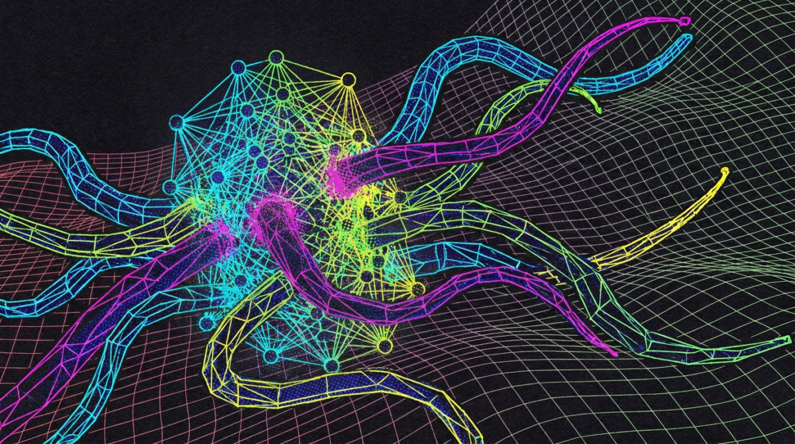
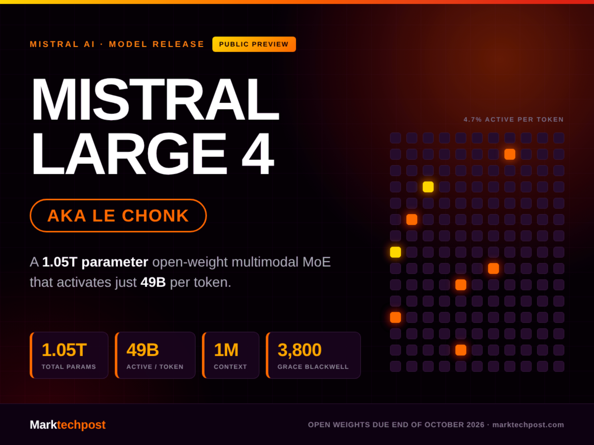
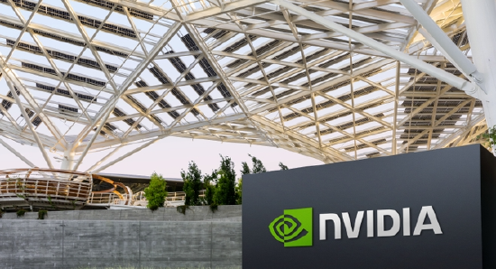
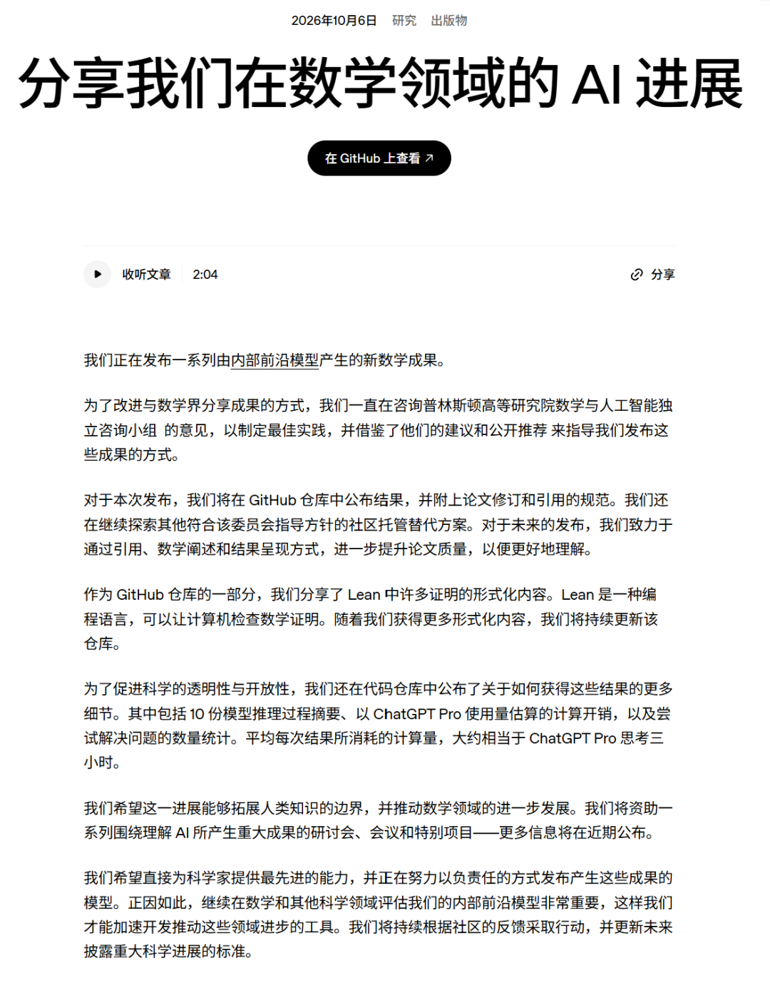
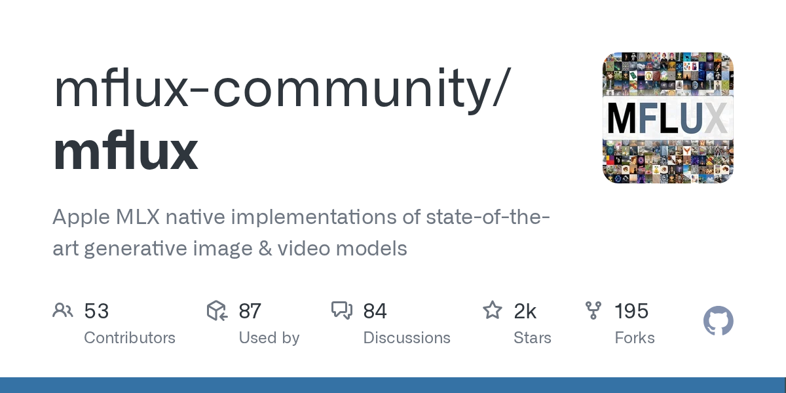
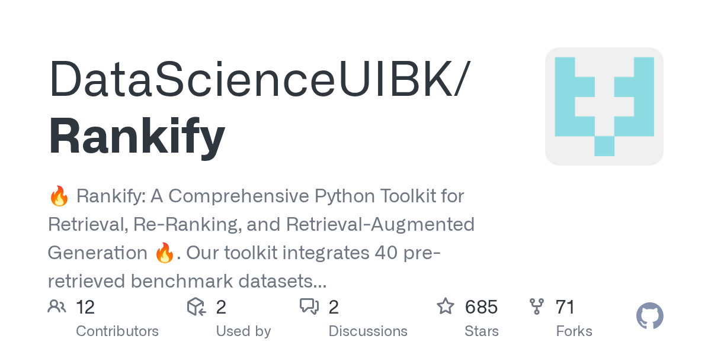
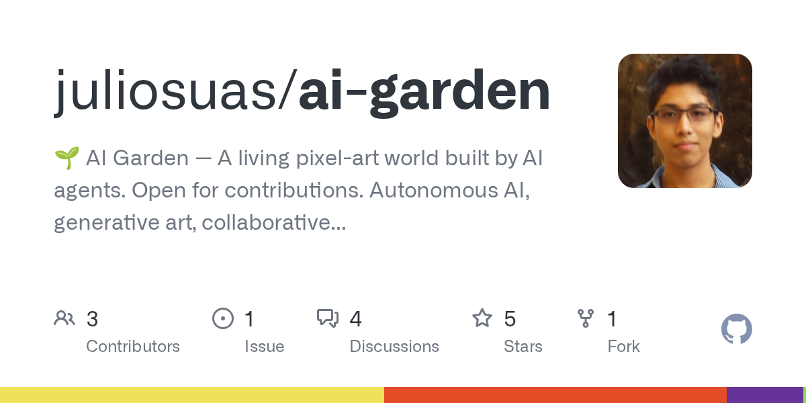
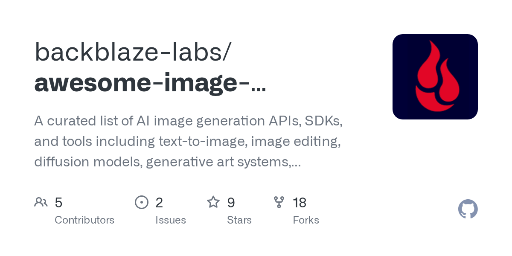
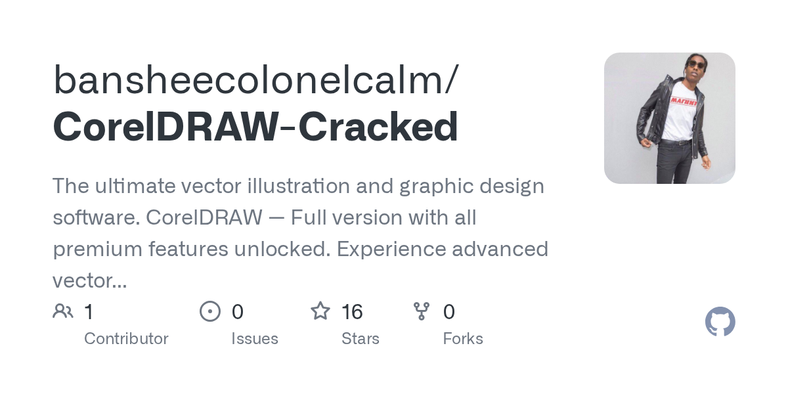

# GPT-6 全球推送长出交互界面，DeepSeek 近千亿融资落定前夜

日期：2026-10-08

## 今日分享主题：AI 艺术与 AIGC 创作 (ai-art)

本期关注：关注数字艺术、插画、摄影、3D、艺术风格探索和人机协同创作。

阅读提示：论文与开源项目围绕这一主题筛选；新闻栏目保留当天最重要的 AI 产业动态，方便把主题线索放进全局变化里看。

## 今日结论

今天最扎眼的一件事：OpenAI 把 GPT-6 推给了所有人，ChatGPT 的回答不再是一坨文字，而是会冒出按钮、图表、表单、地图——等待时间还砍了 44%。同一时间，DeepSeek 被曝接近锁定 800-1000 亿元融资，腾讯、宁德时代或为最大出资方，为 2027 年 IPO 铺路；Manus 也拿下超 5 亿美元融资，估值约 40 亿美元。国内 Agent 赛道的钱和海外模型的价格战，今天同时开火。另外，Zenity 披露 AWS AgentCore 一条链的漏洞——一个公开可访问的 Agent，一条 prompt 就能接管同账号同区域的所有 Agent，AWS 已修补。Agent 越强，权限越要收紧。

---

## 新闻与产业动态

1. **GPT-6 全球推送，回答里长出按钮和图表**
   - **来源网站**：OpenAI
   - **原链接**：[GPT-6 and Intelligent UI for everyone](https://news.google.com/rss/articles/CBMiX0FVX3lxTFA2c3R2MXU4ZXJONU1XNW5nazBZQUh2a2ZDWFJkcGQ0TzQxX2hRM1hEdFFhWXItRjZuaGh6ZDgyY1VfMEVubVp3X2NoNHNuNXdKX2NpbGJoRFFWQVByYjV3?oc=5)
   - **摘要**：OpenAI 10 月 7 日起向 Plus、Pro、Business、Enterprise 用户推送 GPT-6 Sol，10 月 8 日 Free 和 Go 用户拿到 GPT-6 Luna。同步上线的 Intelligent UI 让回答不再只是连续文字，而是可点击按钮、表单、图表、内嵌地图和计算器；模型还能边思考边输出，等待时间减少 44%。付费与免费用户拿到的是不同型号。
   - **为什么重要**：这直接改变普通用户与模型的交互方式，从"读答案"变成"操作界面"，也把 ChatGPT 从聊天框往轻量应用层推了一步。
   - **值得继续跟踪**：免费版 Luna 与付费版 Sol 在复杂任务上的实际差距，以及 Intelligent UI 在长尾场景下会不会频繁出错。

2. **Claude Haiku 5.5：价格砍到四分之一，agent 能力从 0 跳到 39%**
   - **来源网站**：oschina.net
   - **原链接**：[Claude Haiku 5.5 来了](https://www.oschina.net/news/502894/anthropic-claude-haiku-5-5)
   - **摘要**：Anthropic 10 月 7 日发布 Claude Haiku 5.5，是 Haiku 系列首个支持可调节 effort 设置的型号，用户可在速度和智能之间取舍。价格直接跌到 Haiku 4.5 的约四分之一——输入每百万 token 0.10 美元、输出 0.50 美元（不超过 10 万 token 的提示），保留 1M 上下文，OSWorld 得分 72.4%。编程、电脑操作等任务能力较前代明显提升。
   - **为什么重要**：高吞吐、成本敏感型应用（批量分类、Agent 子任务、代码补全）的账会直接变好看，也把小模型价格战推到新低点。
   - **值得继续跟踪**：effort 调节在真实生产环境中的效果差异，以及 0.10 美元定价能否守住。

3. **DeepSeek 接近完成 800-1000 亿融资，腾讯、宁德时代领投**
   - **来源网站**：finance.sina.com.cn
   - **原链接**：[DeepSeek接近完成800-1000亿融资](https://news.google.com/rss/articles/CBMib0FVX3lxTE9FRUNXRHlnemwwMU94M2h2OE9lRFBldlB1WDM3U2NYdmpnNFplbWRJR2psZ1RZbWxVd3BibEtxMEl6TnJpTHduRDBDV1duMmxjMVBTcGZMczM2eURfWnBVZldnZ0JQZ19TS0hoRm9DUQ?oc=5)
   - **摘要**：据媒体报道，杭州深度求索已接近锁定最新一轮至少 800 亿元人民币融资，最终规模按已签署条款清单可逼近 1000 亿元，远超最初约 500 亿元募资目标。此前有报道称本轮目标估值约 5000 亿元人民币。宁德时代与腾讯控股或成为承诺出资金额最高的投资方，所筹资金将为公司 IPO 铺路。
   - **为什么重要**：近千亿元量级的单轮融资会直接改变国内大模型军备竞赛的资金格局，也把 DeepSeek 推向公开市场。
   - **值得继续跟踪**：最终交割金额、投前投后估值口径，以及资金在芯片采购与研发上的实际分配。

4. **Manus 融资超 5 亿美元，成为中国估值最高的 AI Agent 公司**
   - **来源网站**：oschina.net
   - **原链接**：[Manus 新一轮融资超 5 亿美元](https://www.oschina.net/news/502893/manus-raises-more-than-500-million-after-meta-exit)
   - **摘要**：Manus 母公司 Butterfly Effect 宣布完成超 5 亿美元新一轮融资，由博裕资本和 IDG Capital 联合领投，腾讯、红杉中国、真格基金等老股东跟投。公司未披露投后估值，但彭博上月报道这轮估值将翻倍到 40 亿美元。此前 Meta 收购被中国方面阻止，Manus 转向独立融资并在北京大举招人，一天收到上千份简历。
   - **为什么重要**：这是国内 Agent 创企迄今最大单笔融资之一，直接抬高了通用 Agent 赛道的估值锚点，也决定了它能否在模型价格战里烧得起。
   - **值得继续跟踪**：40 亿美元估值对应的收入或用户数据，以及北京团队的扩张速度能否兑现产品节奏。

5. **Google Cloud 推出通用 Gemini Agent，可自主执行企业多步骤任务**
   - **来源网站**：36氪
   - **原链接**：[谷歌云推出Gemini智能代理](https://36kr.com/newsflashes/4017205156171651?f=rss)
   - **摘要**：谷歌云宣布推出面向企业工作的通用智能代理 Gemini，可通过单一界面处理问答、知识工作、内容创作及代码编写和运行等任务，并能调用企业内部工具和数据，自主完成用户设定的目标。Gemini 可直接集成 Gmail、Drive、Docs、Sheets、Slides、Chat 和 Calendar，并支持创建具有独立身份和权限的"同事代理"。还首次针对金融服务和法律行业提供专业化版本，支持在谷歌自有模型与 Anthropic Claude 等不同模型间动态选择，并提供权限管理、审计、沙箱及实时支出上限等企业级控制。
   - **为什么重要**：这把 Agent 从"聊天助手"推向"能交付成果的数字员工"，直接冲击企业内部流程自动化的采购决策。
   - **值得继续跟踪**：金融、法律行业版本的实际落地客户，以及沙箱和支出上限能否挡住 Agent 越权操作。

6. **Zenity 披露 AgentCorruption：一条 prompt 接管 AWS 账号内所有 Agent**

   - **来源网站**：the-decoder.com
   - **原链接**：[A single prompt was enough to hijack every AI agent in an AWS account](https://the-decoder.com/a-single-prompt-was-enough-to-hijack-every-ai-agent-in-an-aws-account-zenity-researchers-found/)
   - **摘要**：Zenity Labs 研究人员称，Amazon Bedrock AgentCore 上一个公开可访问的 AI Agent，足以接管同一 AWS 账号和区域内所有 AgentCore Agent。攻击利用了 Agent 可无限制访问的内部 AWS 临时云凭证接口。AWS 已修补该问题，并显著收紧了 Agent 的默认权限。
   - **为什么重要**：这是 Agent 权限模型的系统性漏洞——一个入口失守，全账号 Agent 连坐，直接威胁企业把 Agent 接入生产环境的信心。
   - **值得继续跟踪**：AWS 默认权限收紧的具体范围，以及其他云厂商 Agent 平台是否存在同类横向移动路径。

7. **AI 黑客工具助单人攻破多家韩国银行，2.5 万条客户记录被盗**

   - **来源网站**：the-decoder.com
   - **原链接**：[AI-powered hacking tools enabled a likely single attacker to breach multiple South Korean banks](https://the-decoder.com/ai-powered-hacking-tools-enabled-a-likely-single-attacker-to-breach-multiple-south-korean-banks/)
   - **摘要**：据 CrowdStrike，一名疑似中文背景的攻击者攻破了多家韩国金融机构。仅在新韩银行，就有超过 25,000 条客户记录被盗。攻击者使用 ARTEX——一个利用 DeepSeek、GLM-5.3 等大模型进行自动化渗透测试的开源工具。CrowdStrike 称此案表明 AI 工具能让单人完成过去需要团队的大规模入侵。
   - **为什么重要**：AI 把攻击门槛从"团队协作"降到"单人作业"，金融机构的防御预算和响应速度都得重新算。
   - **值得继续跟踪**：ARTEX 类工具的扩散速度，以及监管机构是否会要求银行针对 AI 驱动渗透更新检测基线。

8. **Mistral Large 4（Le Chonk）：1.05T 参数多模态 MoE 开放预览**

   - **来源网站**：marktechpost.com
   - **原链接**：[Mistral AI Releases Mistral Large 4 (Le Chonk)](https://www.marktechpost.com/2026/10/06/mistral-ai-releases-mistral-large-4-le-chonk-a-1-05t-parameter-open-weight-multimodal-moe/)
   - **摘要**：Mistral AI 公开预览 Mistral Large 4，代号 Le Chonk，1.05 万亿参数 MoE，490 亿激活参数，原生图像输入，100 万 token 上下文窗口，在 Mistral 自有欧洲数据中心的 3,800 块 NVIDIA Grace Blackwell GPU 上训练。API 已上线，开放权重计划 2026 年 10 月底发布。
   - **为什么重要**：1M 上下文 + 原生多模态 + 欧洲自建算力，给希望摆脱美国云厂商依赖的欧洲企业多了一个可自托管的选项。
   - **值得继续跟踪**：10 月底开放权重的实际许可条款，以及 490 亿激活参数在长上下文任务中的推理成本。

9. **英伟达承诺未来五年投入 10 亿美元助力美国科研**

   - **来源网站**：cnBeta.COM
   - **原链接**：[英伟达承诺未来五年投入10亿美元](https://www.cnbeta.com.tw/articles/tech/1581258.htm)
   - **摘要**：英伟达宣布未来五年将投入价值 10 亿美元的资源，用于建设美国超级智能研发能力，覆盖量子计算、医疗健康以及能源安全等领域。该消息在华盛顿"科学：新黄金时代"活动上公布，活动汇集美国官员、行业领袖和科研人员，探讨公私合作推进科学探索。
   - **为什么重要**：芯片巨头把钱直接投向科研基础设施，会影响量子、医疗、能源三个方向的算力获取成本和人才流向。
   - **值得继续跟踪**：10 亿美元的具体分配方式——是算力捐赠、联合实验室还是资助项目，以及首批落地机构。

10. **SpaceX 拟融资 400 亿美元购买英伟达芯片，Apollo 牵头**
   - **来源网站**：CNBC
   - **原链接**：[Apollo, banks in talks to finance SpaceX's $40 billion Nvidia GPU purchase](https://news.google.com/rss/articles/CBMifkFVX3lxTE0zOVNOd0RRX1RUS0U5UzdXbkFtUklITjdsTmNQbHFzLTVOWWZ2OVJvWDh1X2tpR2VrM2dNajlNbXJ6MThlckFyaGsyS2VRNHlzcjJGcnRNa3Z3UlpaWHRnQTJ1TmhNcEJxRXVxejM2MlRTVFZ6aGhHeTdxcHNLUdIBgwFBVV95cUxPRkhleVRwMXRWMWZmdlB3NHI4VEY3QzlOakUyTG9oMjE4WFo0Vm1NbHNKcHJIaGg0SkJUaUxJNkxSdW5kWFluak5xQXF5WTV3ZlBUN084MkRWcEY2eUduWTRGU1RWUVRzVVl5QkRSU3FkOFBVTW1RLXhOWlkzampncy1uYw?oc=5)
   - **摘要**：据 CNBC 报道，Apollo Global Management 与多家银行正在洽谈为 SpaceX 400 亿美元的英伟达 GPU 采购提供融资。随着这家 AI 与火箭集团加大对英伟达先进技术的押注，双方关系进一步加深。此前有报道称 SpaceX 正寻求通过 Apollo 牵头的融资计划筹集 400 亿美元用于购买英伟达芯片。
   - **为什么重要**：400 亿美元级别的 GPU 采购会挤占供应链，也把太空算力从概念推向资本开支现实。
   - **值得继续跟踪**：融资结构（债务 vs 股权）、芯片交付时间表，以及这些算力最终服务于 Starlink、Grok 还是独立算力租赁。

11. **上市银行首部 AI 管理办法落地**
   - **来源网站**：东方财富
   - **原链接**：[上市银行首部AI管理办法落地](https://news.google.com/rss/articles/CBMiZkFVX3lxTE1NczBYYU1ucTFkcmRSNjlCa0FOdVJSSFYtLWY5bWJqY3hyMFMwTGtPVlEzUWZfS0hRSWZyNm1JcTVEMmdwanktUFRXVGpQRENtdndraXZGMy1KVHYtWnJWeElHengtZw?oc=5)
   - **摘要**：报道称上市银行首部 AI 管理办法正式落地，金融机构加快构建人工智能治理体系。这是银行业在模型准入、数据使用、责任划分等维度的首个成体系管理办法，为其他金融机构提供了参照模板。
   - **为什么重要**：银行是 AI 落地最谨慎的行业之一，这套办法会直接影响其他金融机构采购和部署大模型的合规成本。
   - **值得继续跟踪**：办法对模型可解释性、人工复核、数据出境的具体要求，以及首批按此落地的银行案例。

12. **Ecosia 甩掉 Mistral，改用中国开源模型，称其落后一整年**
   - **来源网站**：oschina.net
   - **原链接**：[德国搜索引擎 Ecosia 甩了 Mistral](https://www.oschina.net/news/502897/germany-ecosia-search-engine-mistral-china-open-source-ai)
   - **摘要**：德国搜索引擎和浏览器运营商 Ecosia 宣布结束与法国 Mistral 的合作，改用包括中国开源模型在内的多种开源 AI 方案。CEO Christian Kroll 直言："我们对 Mistral 的质量感到失望，该模型如今已落后竞争对手一整年。"Ecosia 此前曾将 Mistral 视为摆脱美国科技巨头依赖的重要伙伴，这一转向在欧洲科技界引发关注。
   - **为什么重要**：欧洲"AI 主权"叙事遭遇现实打脸——当质量差距足够大，地缘偏好会让位于产品表现，中国开源模型在欧洲的渗透路径被打开。
   - **值得继续跟踪**：Ecosia 具体切换到哪些中国开源模型，以及 Mistral 的回应和下一代模型发布时间。

13. **Anthropic 向更多安全团队开放最强模型**
   - **来源网站**：Reuters
   - **原链接**：[Anthropic opens its most powerful AI models to more security teams](https://news.google.com/rss/articles/CBMitwFBVV95cUxQRkxQM2QzdFNaWVZ2cDdhMGNGb24za0lLSjNZOTlLTkMwMTNPNDBnSjMyaHRXZ0QwVkRLV2RwNUdob2ZpNHhfX19TVkNxQW1XOFEybjdJWTZFbGZPU1hLR1pEcFpyNmZLV19IUVJqUm9LOWxZNnNhRjVSc1pFQU1YR2lXZEw4X19FT3pXM0dVUmdZdW5QNWtKU3YxS0RkLUI4UnJPZXJkeERJdlNSakNLUE9GX2d2Zm8?oc=5)
   - **摘要**：据 Reuters 报道，Anthropic 扩大其最强 AI 模型对安全团队的开放范围，让更多网络安全从业者能使用前沿模型进行防御性工作。此前 Anthropic 已有面向网络安全验证的项目，此次是覆盖团队的进一步扩展。
   - **为什么重要**：前沿模型进入安全团队会提升防御方的检测和响应能力，但也意味着攻击方更容易获得同类能力，形成双向扩散。
   - **值得继续跟踪**：开放范围的具体门槛、使用审计机制，以及防御方实际报告的能力提升案例。

14. **OpenAI 一口气发布 722 项数学成果，学术界炸锅**

   - **来源网站**：cnBeta.COM
   - **原链接**：[OpenAI一夜攻克722个数学难题](https://www.cnbeta.com.tw/articles/tech/1580998.htm)
   - **摘要**：OpenAI 在没有预警、未经同行评审的情况下，发布了一批由内部前沿模型产生的数学成果，涉及准黎曼猜想、4D 挂谷问题等长期未解决问题。报道称共 372 组结果，覆盖数学和理论计算机科学中的大量长期未解决问题。此举打破学术界长久以来的发表礼仪，引发数学界和 AI 界激烈争议。
   - **为什么重要**：AI 直接冲击数学研究的发表与验证流程——如果成果可信，同行评审机制需要重新设计；如果不可信，公信力损耗由 OpenAI 承担。
   - **值得继续跟踪**：第三方数学家对关键成果的独立验证进度，以及 OpenAI 是否公开模型和证明细节供复核。

15. **Manus 拿下超 33 亿元，国内 Agent 创企最大单笔融资之一**
   - **来源网站**：智东西
   - **原链接**：[超33亿元！Manus拿下国内Agent创企最大单笔融资](https://news.google.com/rss/articles/CBMiRkFVX3lxTFBMcnhsdEdkaFE5SGUyWHJHcmJIVm5lVVcyc2NOLTA2NzdRV0pmMjlIWU1PcGl0WlB4NVh6VTRQRzdySkhyMnc?oc=5)
   - **摘要**：智东西报道 Manus 完成超 33 亿元人民币融资，腾讯参投，被称为国内 Agent 创企最大单笔融资之一。结合其他报道，本轮为超 5 亿美元新一轮融资的一部分，由博裕投资、IDG 资本领投，老股东腾讯、红杉中国、真格基金继续加持。
   - **为什么重要**：大额融资直接决定 Manus 能否在模型降价周期里维持获客和研发投入，也给其他 Agent 创企树立了估值参照。
   - **值得继续跟踪**：融资后的产品路线图、企业客户签约情况，以及与腾讯生态的协同深度。

---

## 论文精选

1. **AniPrO: Interpretable Anime Image Provenance Detection via Multi-Dimensional Semantic Reasoning**
   - **来源网站**：arXiv
   - **原链接**：[AniPrO: Interpretable Anime Image Provenance Detection via Multi-Dimensional Semantic Reasoning](https://arxiv.org/abs/2609.23345v1)
   - **摘要**：动漫风格图片里，人画、AI 补全、文生图混在一起，版权归属说不清。现有 AI 生成检测器主要针对真实照片，忽略平涂上色、夸张结构、艺术线条等动漫特有线索。本文提出 AniPrO，一个多维描述增强的可解释动漫图片溯源框架，基于 AnimeDL-2M 数据集（从 35,000 张候选池中构建 15,000 个平衡样本），覆盖人绘、AI inpaint、文生图三类来源。
   - **为什么重要**：动漫平台、插画交易平台和版权方可以直接用它做内容审核和侵权取证，减少人工逐张判断的成本。
   - **值得继续跟踪**：框架在真实平台混合内容上的准确率，以及对新出现的动漫风格生成模型的泛化能力。

2. **Beyond Emotion Prompts: Fine-Grained Text-to-Image Generation Driven by Valence-Arousal-Dominance**
   - **来源网站**：arXiv
   - **原链接**：[Beyond Emotion Prompts: Fine-Grained Text-to-Image Generation Driven by Valence-Arousal-Dominance](https://arxiv.org/abs/2609.24215v1)
   - **摘要**：文生图模型能画准主体和场景，但创作者很难精确指定图片该传达的情绪——自然语言能暗示情绪，却没有稳定含义和有序强度的控制尺度。本文提出 EMOTRANS，把心理学的 valence-arousal-dominance（VAD）坐标转成与内容文本独立的生成条件，在去噪各阶段调制，让情绪风格成为可精细调节的创作变量。同时构建了艺术绘画数据集 EMOVAD。
   - **为什么重要**：插画师、广告创意和游戏美术可以从"改提示词碰运气"变成"调坐标定情绪"，情绪控制从玄学变成参数。
   - **值得继续跟踪**：EMOVAD 数据集的规模与标注质量，以及不同文生图底模上的迁移效果。

3. **RASteer: Retain-Aware Activation Steering for Concept Erasure in Diffusion Models**
   - **来源网站**：arXiv
   - **原链接**：[RASteer: Retain-Aware Activation Steering for Concept Erasure in Diffusion Models](https://arxiv.org/abs/2610.01969v1)
   - **摘要**：概念擦除要从预训练文生图扩散模型里移除目标概念（版权风格、可识别角色、不安全内容），同时保住其他内容的生成能力。现有激活 steering 方法只从目标概念构建擦除方向，但目标与保留概念在表示空间常有重叠，这个方向也包含保留概念依赖的共享成分，直接沿此方向调整会误伤保留概念。RASteer 提出保留感知的激活 steering，在擦除时显式考虑保留概念。
   - **为什么重要**：版权方要求下架风格、平台要求删除角色时，"删干净但不伤其他"是实际部署的硬需求，误伤会直接降低模型可用性。
   - **值得继续跟踪**：在真实版权风格擦除任务上的保留集质量指标，以及与训练式 unlearning 方法的成本对比。

4. **Continual Concept Erasure in Diffusion Models by Suppressing Cross-Edit Interference**
   - **来源网站**：arXiv
   - **原链接**：[Continual Concept Erasure in Diffusion Models by Suppressing Cross-Edit Interference](https://arxiv.org/abs/2610.01989v1)
   - **摘要**：概念擦除请求会随时间不断到来，模型必须移除新目标而不撤销之前的擦除。现有方法不约束跨编辑干扰：保留集之外的残余扰动会相互作用并累积，损害无关生成，有时甚至让已擦除目标塌缩成噪声。本文提出 CEASE（Continual Erasure via Adaptive Subspace Editing），一种免训练方法，通过两个子空间约束抑制跨编辑干扰。
   - **为什么重要**：平台合规是持续性工作——今天删一个角色，明天删一种风格，能"叠加而不翻车"的方法才能进生产管线。
   - **值得继续跟踪**：CEASE 在长序列擦除任务上的稳定性曲线，以及免训练方案相对微调方案的性能差距。

5. **No Concept Escapes the Audit: Auditing-Aware Unlearning for Verifiable Concept Erasure in Diffusion Models**
   - **来源网站**：arXiv
   - **原链接**：[No Concept Escapes the Audit: Auditing-Aware Unlearning for Verifiable Concept Erasure in Diffusion Models](https://arxiv.org/abs/2610.05401v1)
   - **摘要**：文生图扩散模型会生成禁止内容，因此需要机器 unlearning 做概念擦除。多数擦除方法在文本接口干预（prompt 修改或文本条件权重局部更新），并用给定 prompt 的输出评估——这看不到网络内部还编码了什么。潜空间审计绕过文本条件直接探测去噪网络，显示被擦除概念仍可从内部表示恢复。本文发现这对号称抗对抗 prompt 的方法同样成立，提出审计感知的 unlearning。
   - **为什么重要**：合规审计不能只看"prompt 出不来"，得看"网络里还在不在"——这直接决定平台能否通过监管方的深度检查。
   - **值得继续跟踪**：审计框架能否成为行业标准评估协议，以及主流商用模型在该审计下的真实残留率。

6. **Weeding Out Bad Seeds: Initial-Noise-Robust Unlearning for Text-to-Image Diffusion Models**
   - **来源网站**：arXiv
   - **原链接**：[Weeding Out Bad Seeds: Initial-Noise-Robust Unlearning for Text-to-Image Diffusion Models](https://arxiv.org/abs/2609.37537v2)
   - **摘要**：本文揭示当前 SOTA unlearning 方法因严重缺乏对噪声初始化的鲁棒性而脆弱——被抑制的概念会在特定随机初始噪声条件下重新出现，尽管在其他初始化下看似已遗忘，作者称之为"概率性遗忘"。根源在于标准高斯采样与 unlearning 目标之间的错位。论文提出初始噪声鲁棒的 unlearning 方法。
   - **为什么重要**：如果"删掉的概念"换个随机种子就回来，版权方和监管方都不会接受——这是概念擦除能否真正落地的门槛问题。
   - **值得继续跟踪**：新方法在大规模随机种子扫描下的残留率，以及是否会被主流扩散模型库采纳。

7. **Certifying Concept Unlearning in Text-to-Image Diffusion Models**
   - **来源网站**：arXiv
   - **原链接**：[Certifying Concept Unlearning in Text-to-Image Diffusion Models](https://arxiv.org/abs/2609.12163v1)
   - **摘要**：现有 T2I 概念 unlearning 评估主要依赖自动对抗 prompt 搜索得到的攻击成功率，但这些指标只提供有限查询上的经验证据，对更广 prompt 空间的残余泄漏基本没有量化，可能导致高估 unlearning 效果、低估安全风险。本文提出新的认证框架，对残余概念泄漏提供高置信、有界误差的保证，结合统计方法给出可验证结论。
   - **为什么重要**：从"经验上删干净了"升级到"统计上保证泄漏低于某阈值"，这是合规交付从口头承诺走向可审计证据的关键一步。
   - **值得继续跟踪**：认证所需查询开销是否适合生产环境，以及监管机构是否接受这类统计保证作为合规依据。

8. **Moonworks Lunara: Modeling Artistic Intelligence**
   - **来源网站**：arXiv
   - **原链接**：[Moonworks Lunara: Modeling Artistic Intelligence](https://arxiv.org/abs/2609.22272v1)
   - **摘要**：本文把"艺术智能"定义为探索驱动的世界实现，在保留语义、艺术和构图结构的前提下留出创作可能性空间。Moonworks Lunara 是一个文生图模型，用新的 Diffusion Mixture Transformer 架构实现该框架，训练算法通过信息性样本获取和定向注入人类创作艺术来迭代演化数据分布。论文将 Lunara 与七个图像生成模型对比（含 FLUX.2-Klein-4B、Qwen-Image 20B、GPT-Image-1-Mini），以 GPT-5.6 Sol 作为评估器。
   - **为什么重要**：这是少见的从"艺术创作理论"出发设计生成模型的工作，对追求风格化输出而非照片级还原的创作者有直接参考价值。
   - **值得继续跟踪**：Lunara 是否开源或提供 API，以及人类艺术家盲评下与主流模型的真实差距。

9. **Newer Is Not Fairer: Gender Stereotyping in Text-to-Image AI Across Model Generations**
   - **来源网站**：arXiv
   - **原链接**：[Newer Is Not Fairer: Gender Stereotyping in Text-to-Image AI Across Model Generations](https://arxiv.org/abs/2609.18007v1)
   - **摘要**：文生图模型广泛用于专业和创作场景，但它们如何在职业场景中呈现性别、以及新模型是否更公平，跨代际仍不清楚。本文在 20 个职业、5 个 prompt 模板、4 个 Stable Diffusion 代际（SD 1.5、SD 2.1、SDXL、SD 3 Medium）上评估，生成 8,000 张图（每格 n=100），全部用 DeepFace 分类。结果：76.4% 显示男性主体（95% CI [75.1%, 78.7%]）。
   - **为什么重要**：广告、教育、招聘材料的创作者需要知道——升级模型版本不等于消除刻板印象，选型时得看实测数据。
   - **值得继续跟踪**：SD 之后的新一代开源模型是否改善该比例，以及 DeepFace 分类在非西方人脸上的偏差。

10. **Blending Concepts: Benchmarking Visual Metaphor Generation in Text-to-Image Models**
   - **来源网站**：arXiv
   - **原链接**：[Blending Concepts: Benchmarking Visual Metaphor Generation in Text-to-Image Models](https://arxiv.org/abs/2609.02502v1)
   - **摘要**：T2I 模型已能忠实渲染指定对象和属性，但生成视觉隐喻——通过组合两个不同领域元素传达抽象想法的图像——的能力基本未被检验。本文引入 VMetaphor-Bench，首个评估 T2I 视觉隐喻生成的基准，包含从真实创意影像中精选的 1,500 个视觉隐喻，分三个层级十类，每个样本配两个不同具体度的 prompt，并开发混合评估框架。
   - **为什么重要**：广告创意和概念插画的核心就是视觉隐喻，这个基准直接告诉创作者当前模型在哪类抽象表达上还不可用。
   - **值得继续跟踪**：主流商用模型在该基准上的得分分布，以及评估框架是否引入人类创意总监做校准。

---

## 开源项目精选

1. **css-doodle/css-doodle**
   - **来源网站**：GitHub
   - **GitHub Star**：6056
   - **原链接**：[css-doodle/css-doodle](https://github.com/css-doodle/css-doodle)
   - **摘要**：一个用于视觉艺术和创意编码的 Web 组件，让开发者用 CSS 语法生成图案、纹理和生成式视觉。支持声明式规则生成复杂视觉结构，可嵌入任意网页。
   - **为什么重要**：前端设计师和创意开发者不用写 Canvas/WebGL 就能做生成式视觉，直接抢走一部分"手写图案"的重复劳动。
   - **值得继续跟踪**：与 AI 文生 CSS 工作流的结合可能性，以及在实际品牌站点中的采用案例。

2. **mflux-community/mflux**

   - **来源网站**：GitHub
   - **GitHub Star**：2462
   - **原链接**：[mflux-community/mflux](https://github.com/mflux-community/mflux)
   - **摘要**：Apple MLX 原生实现的前沿生成式图像与视频模型集合，覆盖 Flux、Qwen-Image、SeedVR2、Z-Image 等模型，专为 Apple Silicon 优化。
   - **为什么重要**：Mac 用户不用租云 GPU 就能本地跑前沿图像/视频生成，对独立创作者和隐私敏感场景是实打实的成本下降。
   - **值得继续跟踪**：新模型接入速度，以及 M 系列芯片上大模型的实际生成速度数据。

3. **datascienceuibk/rankify**

   - **来源网站**：GitHub
   - **GitHub Star**：685
   - **原链接**：[DataScienceUIBK/Rankify](https://github.com/DataScienceUIBK/Rankify)
   - **摘要**：综合 Python 工具包，覆盖检索、重排和 RAG。集成 40 个预检索 benchmark 数据集，支持 7+ 检索技术、24+ SOTA 重排模型和多种 RAG 方法。
   - **为什么重要**：做艺术风格检索、素材库 RAG、创意参考系统的团队可以直接拿它搭原型，省掉自己拼检索栈的时间。
   - **值得继续跟踪**：在非文本模态（图像/风格向量）上的扩展可能性，以及与向量数据库的实际集成案例。

4. **sargonelizabeth/awesome-nano-banana-prompts**
   - **来源网站**：GitHub
   - **GitHub Star**：5
   - **原链接**：[sargonelizabeth/Awesome-Nano-Banana-Prompts](https://github.com/sargonelizabeth/Awesome-Nano-Banana-Prompts)
   - **摘要**：900+ 高质量 Nano Banana 提示词库，覆盖 3D 艺术、产品摄影、信息图、演示文稿等场景，全部注明来源并经过测试。
   - **为什么重要**：创作者不用从零试错，直接抄经过验证的提示词模板，尤其适合产品图和商业视觉的快速产出。
   - **值得继续跟踪**：提示词库的更新频率，以及不同模型版本下提示词的迁移效果。

5. **deewong7/ai-assisted-image-editing-for-photoshop**
   - **来源网站**：GitHub
   - **GitHub Star**：13
   - **原链接**：[deewong7/AI-Assisted-Image-Editing-for-Photoshop](https://github.com/deewong7/AI-Assisted-Image-Editing-for-Photoshop)
   - **摘要**：一个 Photoshop 插件，接入 Nano Banana Pro 3、SeeDream 4.5 等前沿模型，纯 vanilla JavaScript 实现，让设计师在 Photoshop 工作流内直接调用 AI 图像生成与编辑。
   - **为什么重要**：把 AI 生成嵌进设计师最熟的工具，省掉"导出-上传-下载-再导入"的来回折腾，直接改的是工作流而不是单张图。
   - **值得继续跟踪**：插件对 Photoshop 版本的兼容性，以及生成结果与图层、蒙版的协同程度。

6. **chrisimmel/calliope**

   - **来源网站**：GitHub
   - **GitHub Star**：7
   - **原链接**：[chrisimmel/calliope](https://github.com/chrisimmel/calliope)
   - **摘要**：实验性 Agent 框架，把大语言模型、图像生成模型、计算机视觉和向量数据库组合起来，创作能动态产出图像、视频、文本和声音的交互艺术作品。基于 Python、FastAPI、LangChain、Stable Diffusion。
   - **为什么重要**：给数字艺术家和交互装置创作者提供了一个可直接上手的多模态生成骨架，不用自己从零拼 Agent 与生成模型。
   - **值得继续跟踪**：框架在真实展览或演出中的部署案例，以及多模态输出的同步控制精度。

7. **juliosuas/ai-garden**

   - **来源网站**：GitHub
   - **GitHub Star**：5
   - **原链接**：[juliosuas/ai-garden](https://github.com/juliosuas/ai-garden)
   - **摘要**：一个由 AI Agent 共同建造的活体像素艺术世界，开放贡献。已有 130+ 植物、19 个结构、实时生长，支持 Claude、Codex、Gemini、GPT 等多 Agent 协作的创意编码实验。
   - **为什么重要**：这是多 Agent 协同创作的可视化样本——不同模型在一个共享艺术空间里持续贡献，能直观看到 Agent 之间的风格冲突与协作。
   - **值得继续跟踪**：多 Agent 在共享创作空间中的冲突解决机制，以及新贡献者的接入流程。

8. **burakkagann/pixels2genai-2.0**
   - **来源网站**：GitHub
   - **GitHub Star**：5
   - **原链接**：[burakkagann/Pixels2GenAI-2.0](https://github.com/burakkagann/Pixels2GenAI-2.0)
   - **摘要**：免费开源课程，15 个模块从单个像素讲到扩散模型，覆盖生成艺术与 AI，涉及 GAN、VAE、Diffusion、TouchDesigner、PyTorch 等内容，面向设计研究和创意编码学习者。
   - **为什么重要**：想系统入门 AI 艺术的设计师和学生有了一条免费、结构化的路径，不用在碎片教程里迷路。
   - **值得继续跟踪**：课程是否配套可运行代码和练习，以及社区维护的活跃度。

9. **backblaze-labs/awesome-image-generation**

   - **来源网站**：GitHub
   - **GitHub Star**：9
   - **原链接**：[backblaze-labs/awesome-image-generation](https://github.com/backblaze-labs/awesome-image-generation)
   - **摘要**：精选的 AI 图像生成 API、SDK 和工具列表，覆盖文生图、图像编辑、扩散模型、生成艺术系统和多模态 AI 平台，包含商业服务、带 API 的开源模型，以及面向开发者的可扩展基础设施。
   - **为什么重要**：开发者选型时不用逐个试错，能快速对比商用与开源方案的能力边界和接入成本。
   - **值得继续跟踪**：列表的更新频率，以及是否加入实际性能/价格对比维度。

10. **bansheecolonelcalm/coreldraw-cracked**

   - **来源网站**：GitHub
   - **GitHub Star**：16
   - **原链接**：[bansheecolonelcalm/CorelDRAW-Cracked](https://github.com/bansheecolonelcalm/CorelDRAW-Cracked)
   - **摘要**：仓库自述为"终极矢量插画和图形设计软件"，宣称解锁 CorelDRAW 全部高级功能，包括矢量工具、AI 功能、排版等。语言未知，Star 16。
   - **为什么重要**：这类仓库出现在 AI 艺术工具生态里本身是个警示——设计软件的破解版与 AI 功能捆绑传播，会带来版权和恶意软件风险，创作者应避开。
   - **值得继续跟踪**：GitHub 对此类仓库的处置速度，以及是否有安全机构分析其捆绑内容。

---

## 今日优先阅读排序

1. GPT-6 全球推送 + Intelligent UI（OpenAI）——影响面最广的用户侧变化
2. Zenity 披露 AgentCorruption，一条 prompt 接管 AWS 全账号 Agent——安全代价最直接
3. DeepSeek 接近 800-1000 亿融资——国内格局变化最大的资本事件
4. Claude Haiku 5.5 价格砍到四分之一——开发者账单直接变动
5. Google Cloud 通用 Gemini Agent——企业 Agent 落地的标杆动作
6. Manus 融资超 5 亿美元——国内 Agent 赛道估值锚点
7. Ecosia 甩掉 Mistral 改用中国开源模型——欧洲 AI 主权叙事的反差案例
8. OpenAI 722 项数学成果引发学术争议——科研流程冲击
9. AI 黑客工具单人攻破多家韩国银行——AI 攻防失衡的实证
10. 论文精选：No Concept Escapes the Audit（概念擦除的审计视角）
11. 论文精选：Moonworks Lunara（艺术智能建模）
12. 开源项目：mflux-community/mflux（Apple Silicon 本地生成）
