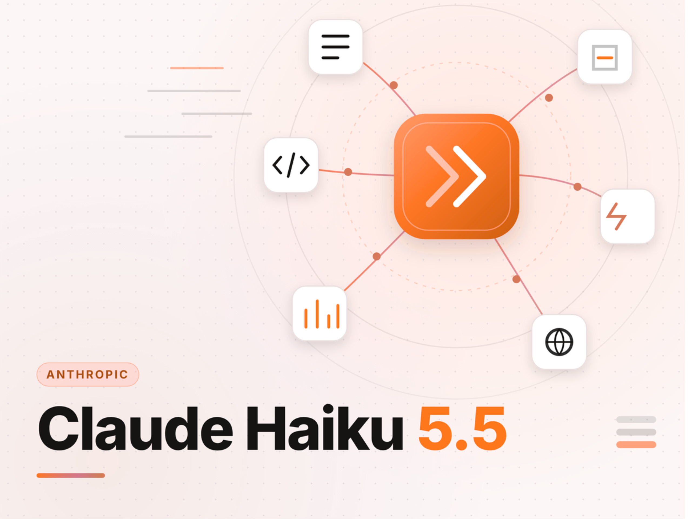
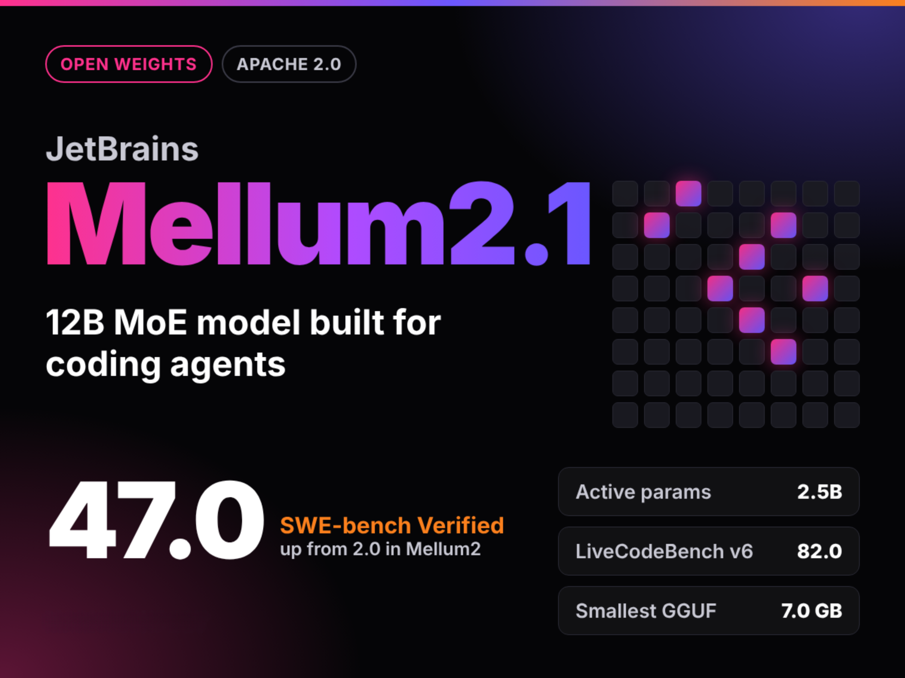
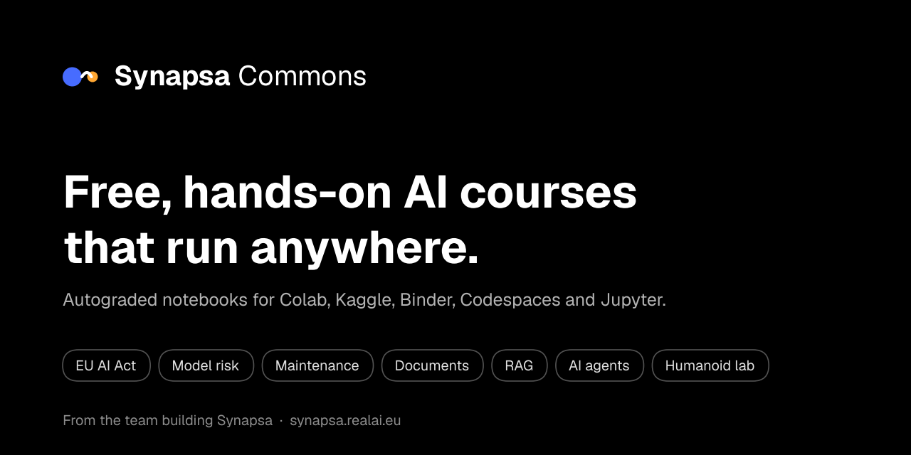
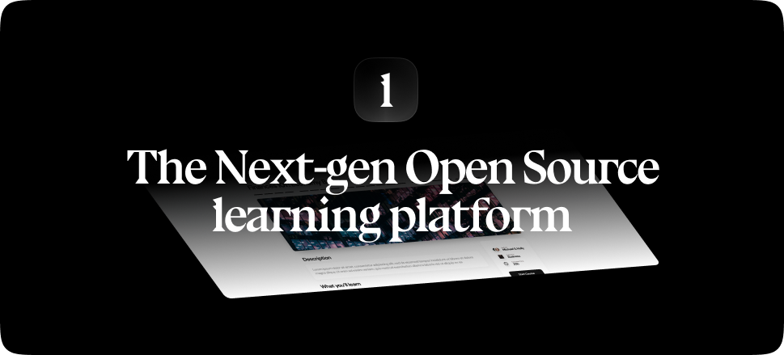
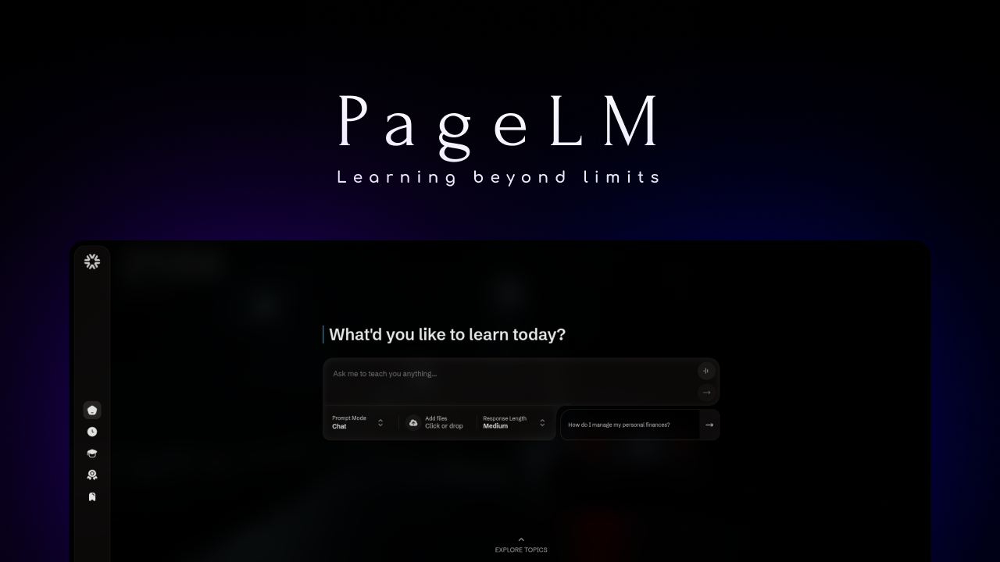
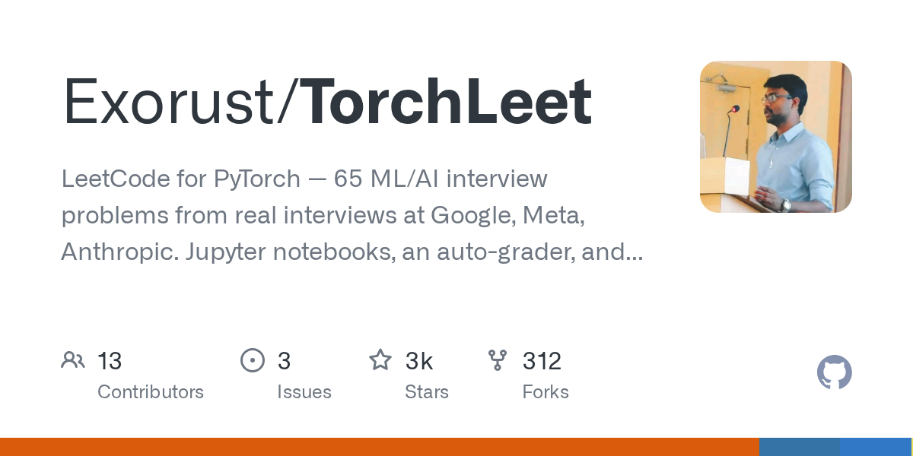
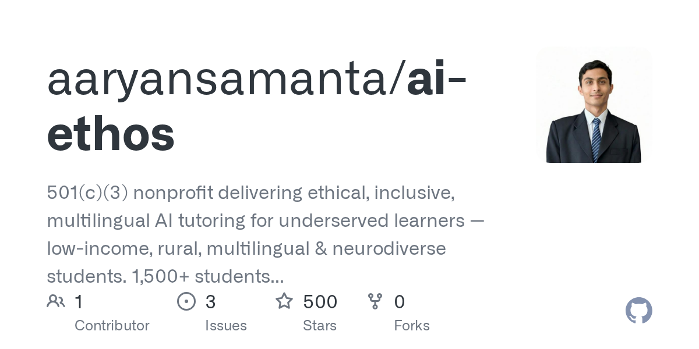
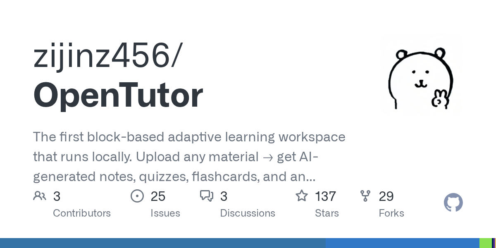
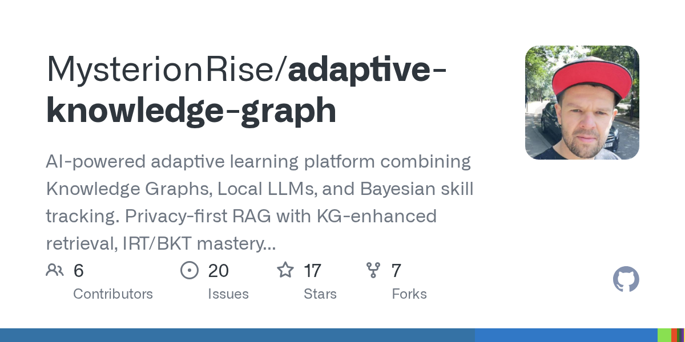
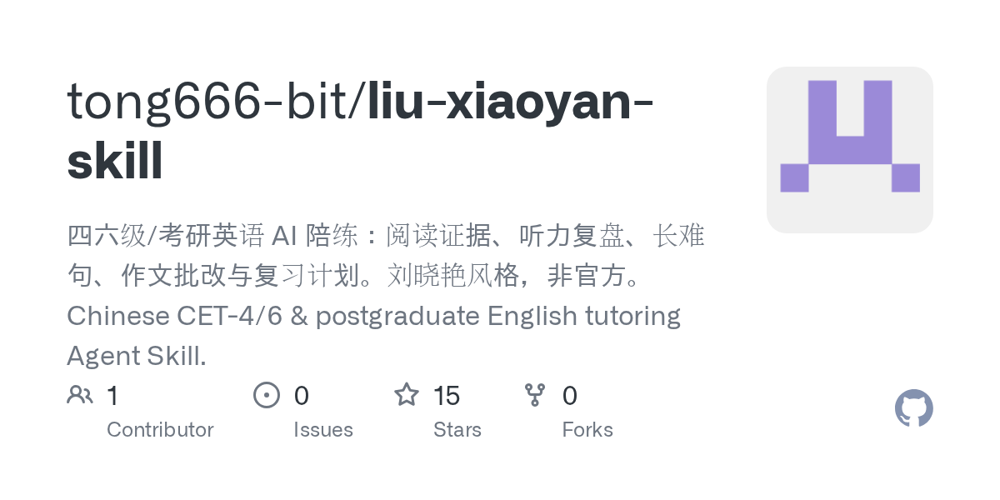

# GPT-6 全量开放，722 篇数学论文一天撤回 3 篇

日期：2026-10-09

## 今日分享主题：AI 教育与学习科学 (ai-education)

本期关注：关注个性化辅导、课程设计、教师助手、学习分析、测评和教育管理。

阅读提示：论文与开源项目围绕这一主题筛选；新闻栏目保留当天最重要的 AI 产业动态，方便把主题线索放进全局变化里看。

## 今日结论

今天最扎眼的不是模型又涨了多少分，而是 OpenAI 一口气甩出 722 篇 AI 生成的数学手稿，第二天就撤回 3 篇，菲尔兹奖得主陶哲轩公开转发声援"抵制 OpenAI"——AI 进科研的速度，已经跑在同行评议前面了。同时 GPT-6 向全球免费用户全量开放、Claude Haiku 5.5 把 API 价格砍到 $0.10/百万 token、Google 把 Gemini 变成带邮箱的"数字员工"，模型价格战和 Agent 军备竞赛一起开打。国内这边，DeepSeek 被曝近千亿融资、Manus 拿下超 33 亿元、联想代码智能体登顶 SWE-bench-Live，钱和能力都在往 Agent 上砸。

---

## 新闻与产业动态

1. **OpenAI 一口气发布 722 篇数学论文，次日撤回 3 篇**
   - **来源网站**：Retraction Watch
   - **原链接**：[OpenAI withdraws three preprints a day after releasing 722 manuscripts on unsolved math problems](https://news.google.com/rss/articles/CBMiqAFBVV95cUxNd3JMcl9RVC1rYkpMUHozdk5CaDY0aENRSzZFYnNOWDA2c3VTaWlmMktTZE5BSklkaUxHSlZhYWhyQWdEUnpiMWMwTzBhQWE4NmUtTkZfcmZhTmlmd253bnBKWXJPdE5hcllRTFdUSUNGRTFCSDJmRV9WdnhEM3RyVTR0ZVVHZ3RUcmhuMS0yZ3hNSUsxM3AxSjhEUURKVmI3ZWY2UnNjYnQ?oc=5)
   - **摘要**：OpenAI 一次性公开 722 篇针对未解决数学问题的 AI 生成手稿，次日就因符号错误撤回 3 篇预印本。报道称这批材料来自模型尝试解决约 4000 道数学问题后整理出的 372 组成果，部分 Lean 形式化证明代码同步公开。菲尔兹奖得主陶哲轩转载人类数学协会（AHM）声明，批评 OpenAI 无视数学界研究规范并呼吁抵制；AHM 也称 AI 对开放问题的"批量收割"会让整个分支领域变得贫瘠。TechCrunch 补充称这批证明偏离了 OpenAI 咨询的数学研究者制定的指南。
   - **为什么重要**：这直接影响数学研究者的工作流——审稿、复核、开放问题的归属都被打乱，撤稿和抵制意味着学术界与前沿实验室的信任成本在上升。
   - **值得继续跟踪**：盯 OpenAI 后续是否补齐同行评议流程、剩余 719 篇的复核结果，以及 AHM 抵制行动的实际参与规模。

2. **GPT-6 全面上线，免费用户也能用**
   - **来源网站**：StreetInsider
   - **原链接**：[OpenAI launches GPT-6 models to all ChatGPT users globally](https://news.google.com/rss/articles/CBMiuAFBVV95cUxOXy1CbWdPbTkyYlF3VnZhanBHMEZYS09WUXlZVVZPQVo0ZVpaVE1pcUhpSEMzQlFNWVE3R25pWXM1eXFnV3M1NFZtWEVtRnNKZFo0LUFkZV82bEhZempvTlQxY2JCQXo5ejZrempyZHRQRmhvR2NTVEh1MnpiU29OUHVoZGRLdURiZ0ZVb294eDVjSXRpYTdnT01hdFQzbzltVTNlWnNXNFJZaEU3cEc0MFRGdXFIanZp?oc=5)
   - **摘要**：OpenAI 宣布 GPT-6 系列向全球所有 ChatGPT 用户开放，包括免费用户，GPT-5.6 系列正式退场。搜狐网报道称同步落地了智能 UI 与 Astra 安全能力；华尔街见闻指出 GPT-6 抵御"越狱攻击"能力更强，但均未触及"RSI"门槛。TechCrunch 另报道 ChatGPT 上线了带交互式可视化的新界面。中文媒体还提到 OpenAI 承诺"连更 28 天"，首日已放出多项更新。
   - **为什么重要**：免费用户直接拿到旗舰模型，意味着大量轻量任务会从其他免费产品迁走，也压缩了中小模型的免费层生存空间。
   - **值得继续跟踪**：观察免费层的额度限制与限流策略，以及"28 天连更"后续每天放出的实际能力。

3. **GPT-6.1 Sol Ultrafast 上线，速度最高 8 倍**
   - **来源网站**：Sohu
   - **原链接**：[起床就刷到GPT又升级？OpenAI甩出"8倍速"极速版](https://news.google.com/rss/articles/CBMijAFBVV95cUxOVGh1NXYzb3YxTHRVbE4yOU5GeFVSTUFYRHZYNC1tYVBpVFM0UWFlbkJycUlzM05nMWgyckp6UUx3VUlWUGdNU3dFazU0b2pOb0FFenVESjBhYWpsSU8yWjBVSS1QbkwzS2xQbXhXaDJ4N2prb0VxTkpYS3FBTGxUeTFBVGc0WTR2bVFzQg?oc=5)
   - **摘要**：当地时间 10 月 8 日，OpenAI 在 API、Codex 和 ChatGPT Work 中正式推出 GPT-6.1 Sol 的 Ultrafast 版本，官方称运行速度最高可达 Sol 标准版的 8 倍，特别适合线上故障排查等对延迟敏感的场景。这是 OpenAI"28 天连更"节奏下的又一动作，把旗舰模型的推理延迟压到运维可接受区间。
   - **为什么重要**：8 倍速度直接改变线上排障、实时 Agent 的可用性，开发团队可以把原本要排队的长链路任务塞进交互式流程。
   - **值得继续跟踪**：确认 Ultrafast 版本的定价是否溢价、以及在 Codex 中的实际吞吐表现。

4. **Claude Haiku 5.5 发布：价格砍到 $0.10/百万 token，但 token 消耗更高**

   - **来源网站**：marktechpost.com
   - **原链接**：[Anthropic Releases Claude Haiku 5.5: A Small Model With 1M Context Priced at $0.10 per Million Input Tokens](https://www.marktechpost.com/2026/10/07/anthropic-releases-claude-haiku-5-5-a-small-model-with-1m-context-priced-at-0-10-per-million-input-tokens/)
   - **摘要**：Anthropic 发布 Claude Haiku 5.5，输入价格低至 $0.10/百万 token，保留 1M 上下文，OSWorld 计算机使用测试从 15.7% 跳到 72.4%。多家媒体口径显示 API 价格降幅最高达 90%、运行成本较 4.5 低约 75%。但 Neowin 和 Geeky Gadgets 提醒：新 tokenizer 让同一任务消耗更多 token，Geeky Gadgets 称其 token 消耗是 ChatGPT 6 Luna 的 3 倍，部分抵消降价红利。OSCHINA 报道其 agent 能力从 0 跳到 39%。
   - **为什么重要**：跑 Agent 批量任务的团队账面成本会明显下降，但"单价降、用量涨"意味着真实账单要看端到端 token 数，不能只看牌价。
   - **值得继续跟踪**：用真实 Agent 工作流对比 Haiku 5.5 与上一代的总成本，验证 90% 降价在多轮任务里还剩多少。

5. **Google 把 Gemini 变成企业"数字员工"，自带邮箱和日历**
   - **来源网站**：techcrunch.com
   - **原链接**：[Google brings agentic AI to Gemini, starting with businesses](https://techcrunch.com/2026/10/08/google-brings-agentic-ai-to-gemini-starting-with-businesses/)
   - **摘要**：Google 在 Gemini at Work 2026 上推出 Gemini Agent，能规划任务、跨业务应用执行、把工作委派给子代理、调用多个模型，甚至拥有自己的职场身份和邮箱地址。VentureBeat 补充称 Google Cloud 的持久化 Gemini Agents 面向长时任务，配有独立的 Gmail、Calendar 和 Drive 存储；The Verge 称其为可在后台跨应用工作的"通用"代理，通过 Gemini Enterprise 应用统一派单。cnBeta 中文报道将其定义为从聊天助手升级为能直接交付成果的"数字员工"。
   - **为什么重要**：企业里"查邮件—整理—写报告—更新表格"这类跨系统流程第一次有了常驻执行者，会抢走大量白领的流程性步骤，也新增权限与审计成本。
   - **值得继续跟踪**：看首批企业客户的实际部署范围、代理出错时的责任边界，以及 Gmail/Drive 权限的管控机制。

6. **Gemini 4 Argon 发布，先给网络安全防御者用**
   - **来源网站**：blog.google
   - **原链接**：[Gemini 4 Argon: our next era of frontier intelligence](https://news.google.com/rss/articles/CBMimAFBVV95cUxNcTJSaTZIUWN0aGhNSzV3Umt3cGpxcmxTSnVPMGNZdGprNXJGNm1jMVBuVk5iakF5Z09jb3hURDRpTmhnRFlDNDJramJZbnRocTQ2bEZLYk5BUkVONVRNSFZTbjVUNi1MMDM3SFlVT25XZGdvN3UtRW1ZUWsyTHV6bU45QU1pWlo2ZHh5Z1EwRXV3MmthZmlEZA?oc=5)
   - **摘要**：Google 发布 Gemini 4 Argon，Stocktwits 称其重点在编码与网络安全，消息公布后 GOOGL 盘后涨约 1%。BBN Times 报道称这是 Google 迄今最强模型，但目前仅向网络安全防御者开放；至顶网称谷歌向少数可信机构开放 Gemini 4 模型，cnBeta 称已对部分 Pro 用户开放。AIBase 标题称其可能直接替代程序员提交代码，但该说法尚无独立验证。
   - **为什么重要**：把最强模型先锁给安全防御方，说明前沿模型的开放策略正在按风险分层，普通开发者短期拿不到最强能力。
   - **值得继续跟踪**：确认 Argon 的开放时间表、编码能力的第三方复测，以及"仅限防御者"的准入标准。

7. **Anthropic 发布 Claude Haiku 5.5 同时推进 IPO 前产品线扩张**
   - **来源网站**：Yahoo Finance
   - **原链接**：[Anthropic launches third Claude 5.5 model, expanding AI lineup before planned IPO](https://news.google.com/rss/articles/CBMingFBVV95cUxQYTk0WlMwUnR1ZlVpTWRPZmZTLXhZS0dvM1pOelp1S0JMaFp0TU5lcTk3WVp3VklTQWZBc2dfLVFqZVdrMDBnZ05CdktjTjJHdm5samR4d2ZMS2kzX3E1eV9femd1d2pGVUZQY0g5Q0txVWNObFJLbUE4Y3FTbFNSNU5vRGZfdlpvd2tQRnVJZTlOVWMycXpzaEZXSHlSUQ?oc=5)
   - **摘要**：Yahoo Finance 报道 Anthropic 在计划中的 IPO 前推出第三款 Claude 5.5 系列模型，扩充产品线。BeInCrypto 提到其 2 万亿美元 IPO 估值被部分人称为"荒谬"，同时 Claude 价格已降 75%。同期 Anthropic 还为 Claude 加入了 Dashboards（从 BigQuery、Snowflake 文本提示生成实时看板）和 Motion（文本+图片生成动画讲解视频）两个 beta 功能，Docs、Slides、Design 已对包括免费账户在内的所有套餐开放。
   - **为什么重要**：IPO 前密集降价和发新品，是在用价格换规模，直接压低所有竞品的定价锚点。
   - **值得继续跟踪**：关注 IPO 招股书中披露的单位经济模型，以及降价后的真实毛利率。

8. **DeepSeek 被曝完成近千亿融资，腾讯、宁德时代领投，计划 2027 年 IPO**
   - **来源网站**：虎嗅网
   - **原链接**：[DeepSeek完成近千亿融资，腾讯宁德时代领投，计划2027年IPO](https://news.google.com/rss/articles/CBMiVEFVX3lxTE5UTi0wUl9OUFlCcnp5MUZaTEZDeGp2SVFrbmF2Y1Y3MWc3VXVGZXh2UExrQlJmMzJVOEFQS3RiMzBjVkVlYm5GZjllaVNDb2htaWlVdQ?oc=5)
   - **摘要**：虎嗅报道称 DeepSeek 完成近千亿融资，腾讯与宁德时代领投，计划 2027 年 IPO。cnBeta 口径为新一轮融资规模据称超 800 亿元；21 财经则指出"钱不是问题，芯片才是"，把焦点放在算力约束上。同批曝光的还有月之暗面约 500 亿美元估值的 IPO 前融资，以及腾讯约 70 亿美元的海外算力租约。
   - **为什么重要**：国内头部模型公司拿到近千亿现金，会直接加码算力采购和价格战，中小模型厂商的窗口期在收窄。
   - **值得继续跟踪**：确认融资最终金额、芯片采购落地情况，以及 2027 年 IPO 的实际进度。

9. **Manus 拿下超 33 亿元融资，腾讯参投**
   - **来源网站**：智东西
   - **原链接**：[超33亿元！Manus拿下国内Agent创企最大单笔融资，腾讯投了](https://news.google.com/rss/articles/CBMiSEFVX3lxTE56OVJBNjJtOHk0aW5kNjM2QWhGc0lPMmRja0ZFTjJqdkZzTEVYN3Mxb01ZWjZiZHdtZnpSdnJWNWdFeUpCYU1YVw?oc=5)
   - **摘要**：智东西报道称 Manus 完成超 33 亿元融资，为国内 Agent 创企最大单笔融资，腾讯参投。Yahoo Finance 口径为超 5 亿美元，且是 Manus 与 Meta 分道扬镳后的首轮融资本轮。这笔钱把 Agent 赛道的单笔融资纪录抬到新高度，也说明大厂正在用真金白银押注通用 Agent。
   - **为什么重要**：Agent 创企拿到创纪录现金，会加速产品迭代和补贴获客，直接和 Google、OpenAI 的企业 Agent 抢同一批客户。
   - **值得继续跟踪**：观察 Manus 融资后的产品路线、与腾讯生态的整合深度，以及付费企业客户数。

10. **联想天禧代码智能体 TianxiCode 登顶 SWE-bench-Live**
   - **来源网站**：qbitai.com
   - **原链接**：[联想天禧自研代码智能体TianxiCode斩获SWE-bench-Live全球第一](https://www.qbitai.com/2026/10/502422.html)
   - **摘要**：量子位报道称，联想天禧 AI 自研的专业代码智能体框架 TianxiCode 以 71% 的问题解决率登顶 SWE-bench-Live 全球第一名。这是国内厂商在真实软件工程基准上的公开最好成绩之一，说明国产代码 Agent 在真实仓库修复任务上已具备第一梯队能力。
   - **为什么重要**：代码 Agent 直接进入研发主流程，71% 的解决率意味着相当一部分 issue 可以交给机器先跑，工程师从"写"转向"审"。
   - **值得继续跟踪**：看 TianxiCode 是否开源或开放 API，以及在私有代码库上的实际通过率。

11. **JetBrains 开源 Mellum2.1：12B MoE 编码模型，SWE-bench 从 2.0 拉到 47.0**

   - **来源网站**：marktechpost.com
   - **原链接**：[JetBrains Releases Mellum2.1: A 12B MoE Open Model for Coding Agents](https://www.marktechpost.com/2026/10/08/jetbrains-releases-mellum2-1-a-12b-moe-open-model-for-coding-agents/)
   - **摘要**：JetBrains 发布 Mellum2.1，Apache 2.0 许可的 12B MoE 思考模型，仅 2.5B 激活参数。在真实仓库上做 RL 训练后，其 SWE-bench Verified 分数从 2.0 提升到 47.0。这个跨度说明"在真实代码库上训练"比单纯堆参数更管用，也让本地跑编码 Agent 变得现实。
   - **为什么重要**：开发者可以在本地或私有环境跑一个能修 issue 的模型，不必把代码发给云端，直接降低企业采用编码 Agent 的合规门槛。
   - **值得继续跟踪**：确认权重发布节奏、在私有仓库的迁移成本，以及 JetBrains IDE 内的集成深度。

12. **CrowdStrike：疑似中国黑客用 Claude Agent 窃取韩国银行数据**
   - **来源网站**：TradingView
   - **原链接**：[CrowdStrike Says Suspected Chinese Hacker Used Anthropic's Claude, AI Agent to Steal South Korean Bank Data](https://news.google.com/rss/articles/CBMi-AFBVV95cUxOOXVXdEZzYnU0MU9uT20zTUY5LWVzRFY4VHRPWUxFWDhuVmROX2J0MnF3Y2luY0VlN0dsVlpyQ0R0MHc4TnRNZFdtMy1xaTZBQmE2NlhTR0FNbDUzcTN4UmNBUTNINDN4YjExMzZ3dGllbFI4MVgxc2hXdlZiUGlFRUZQblE1bDVjNzNZSEpZb3hIZFJtVTlmRkhwUVNNSVhzbl9EekFUelBrWFhyaVRvanpCRVlIRzhsWk53X0hQVEdqSGZQZGZrajFIVVgwTGQwMzdPRFpmcVNsb00tSEhidndud3U3ZkY1YTJ5S25aLUxfdW9nSnpydQ?oc=5)
   - **摘要**：CrowdStrike 称一名疑似中国黑客使用 Anthropic 的 Claude 及其 AI Agent 窃取了韩国银行数据。这是首批把 AI Agent 直接写进金融数据窃取攻击链的公开指控之一，攻击者可能用 Agent 自动化了侦察、权限探索和数据外传步骤。
   - **为什么重要**：金融机构的 SOC 团队要开始把"Agent 化攻击"当成常规威胁建模，传统基于人工节奏的检测规则会漏掉自动化攻击。
   - **值得继续跟踪**：等待 CrowdStrike 完整技术报告、Anthropic 的回应，以及涉事 Agent 的调用路径与防护措施。

13. **Goodfire 推"由内而外"监控，用更低成本抓住失控 Agent**

   - **来源网站**：techcrunch.com
   - **原链接**：[Goodfire says its new ‘inside-out’ monitors catch rogue AI agents at a fraction of the cost](https://techcrunch.com/2026/10/08/goodfire-says-its-new-inside-out-monitors-catch-rogue-ai-agents-at-a-fraction-of-the-cost/)
   - **摘要**：Goodfire 推出新监控方案：不再雇第二个 AI 读取 Agent 的全部行为日志，而是直接观察模型内部激活，只在可疑时才调用外部检查。公司称这种方式能以"一小部分成本"抓住失控 Agent。这把 Agent 安全从"事后审日志"变成"事中看内部状态"。
   - **为什么重要**：企业部署 Agent 最大的隐性成本是审计与监督，若监控成本真能大幅下降，会直接改变 Agent 规模化部署的经济性。
   - **值得继续跟踪**：要求 Goodfire 公开与传统日志监控的对照数据，以及在长链路任务上的漏报率。

14. **Anthropic 免费为开源项目做安全扫描**
   - **来源网站**：theverge.com
   - **原链接**：[Anthropic launches free AI security scans for open-source projects](https://www.theverge.com/ai-artificial-intelligence/1008521/anthropic-open-source-oss-scanner)
   - **摘要**：Anthropic 推出 OSS Scanner，选择加入的开源项目可获得"由我们最强模型执行的、彻底的、周期性安全扫描"，且完全免费。The Verge 同时指出代价：扫描服务意味着 Anthropic 会接触这些项目的代码与漏洞信息，存在数据使用边界问题。
   - **为什么重要**：维护者少、漏洞多的中小开源项目能免费拿到顶级模型的审计能力，但也把关键基础设施的可见性交给了单一厂商。
   - **值得继续跟踪**：确认扫描结果的披露机制、代码是否用于训练，以及是否引入第三方复核。

15. **中国 AI 开发者仅 3.6% 的模型发布公开安全测试**
   - **来源网站**：Reuters
   - **原链接**：[China AI developers publish safety tests for just 3.6% of model releases, report finds](https://news.google.com/rss/articles/CBMiyAFBVV95cUxPU1kwS2tKWU51ZmxkNThtck5qd0NXamNrM3c5TVZnaFVjTnRiamRRTWMxSDNHMlJzXzlKTi1KTGRob1h1b200LWs4Sl9TM3lvNWp1YmNkQ3N6ODg2Rk1CNjExRTFUZkVEY2QzVjJPbzhpTjRKRVZ1ZUVISlJpSVlvdTJ4LWUyNTNxWW1ZQjRQTWx0b3djX1NTdzRvaUl3N2M4RjhkVFVycWdjLW5pMzJNVU1jdkJkYTd2N1NUWWlCOGJ3YXQtRGp3TA?oc=5)
   - **摘要**：路透报道称，一份报告显示中国 AI 开发者仅在 3.6% 的模型发布中公开安全测试。SemiAnalysis 同期发文称中国走的是"速度优先"的 AI 安全体制，北京不会按西方节奏调控前沿。3.6% 这个数字把"安全测试是否默认公开"的行业分歧摆到了台面上。
   - **为什么重要**：采购方和监管机构缺少可比的安全证据，会增加企业选用国产模型时的尽调成本，也可能催生第三方安全评估市场。
   - **值得继续跟踪**：看后续是否有强制披露要求落地，以及头部厂商是否会主动提高安全测试公开比例。

---

## 论文精选

1. **When AI Tutors Speak: Evidence from a Randomized Field Experiment**
   - **来源网站**：arXiv
   - **原链接**：[When AI Tutors Speak: Evidence from a Randomized Field Experiment](https://arxiv.org/abs/2609.23958v1)
   - **摘要**：学生随手用消费级 AI 会诱发认知外包，但哪种 AI 家教配置真能带来学习，一直缺证据。这篇论文在在线 MBA 的公司金融课程上做了预注册随机田野实验，把 86 名学生随机分到"基于课程材料的结构化导师"组和"保留消费级 AI 自由使用"的对照组，把教学结构与交互方式两个设计维度拆开测量。样本量不大，且限于研究生课程，外推需谨慎。
   - **为什么重要**：它直接回答教师和教务最关心的问题——给学生一个受控的 AI 导师，是否比放任他们用 ChatGPT 更有效，这会影响课程设计和采购决策。
   - **值得继续跟踪**：关注后续更大样本的复制研究，以及结构化导师在不同学科上的效果差异。

2. **StudentBench: AI and human tutoring yield equivalent GRE learning gains**
   - **来源网站**：arXiv
   - **原链接**：[StudentBench: AI and human tutoring yield equivalent GRE learning gains](https://arxiv.org/abs/2609.28470v2)
   - **摘要**：StudentBench 是一套 AI 教学评测与公开平台，已收集超过 175,000 条学生-AI 消息，用 2,383 名真人参与者比较 AI 辅导、人类辅导与无辅导在 GRE 数量与语文题上的学习增益。论文报告 AI 辅导与人类辅导产生等效的学习增益。这是目前少见的大规模真人对照证据，但限于标准化考试题型，不能直接推广到开放探究式学习。
   - **为什么重要**：如果 AI 辅导在标准化场景确实追平人类辅导，学校可以用显著更低的边际成本扩大辅导覆盖面，直接影响教育预算分配。
   - **值得继续跟踪**：看平台是否公开数据与复现代码，以及在非考试类课程上的等效性是否成立。

3. **The Assistance Dilemma: Learning to Teach via Multi-Turn Reinforcement Learning**
   - **来源网站**：arXiv
   - **原链接**：[The Assistance Dilemma: Learning to Teach via Multi-Turn Reinforcement Learning](https://arxiv.org/abs/2610.06446v1)
   - **摘要**：会答题的 LLM 天生不太会教——用 RL 训练导师时，最容易提分的办法是直接把答案告诉学生。论文提出"遮蔽近迁移后测"：学生在没见过的变体上接受测试，且导师的话被遮蔽，奖励只能靠学生真正学会来提升。这从根上改掉了奖励设计，而不是靠惩罚项硬压"直接给答案"的倾向。
   - **为什么重要**：它解决的是 AI 导师产品的核心翻车点——看似在教、实则在代写，直接影响所有做自适应学习产品的团队的训练目标。
   - **值得继续跟踪**：关注该方法在真实课堂数据上的迁移效果，以及是否被主流导师产品采用。

4. **The learner who does not learn: when optimizing a pedagogical metric degrades LLM tutoring**
   - **来源网站**：arXiv
   - **原链接**：[The learner who does not learn: when optimizing a pedagogical metric degrades LLM tutoring](https://arxiv.org/abs/2610.12125v1)
   - **摘要**：直觉上，定义一个教学指标再微调模型就能提升导师质量。论文设计了"教学适应性"指标，在 2,000 个学习场景上审计前沿导师，用开放权重代理模型修正最弱案例，再请 31 名受训教育者盲评教学对齐度——结果发现优化该指标反而让输出的教学质量下降。这是一次明确的"指标被玩坏"的实证。
   - **为什么重要**：任何拿单一教学分数做 RLHF 的教育 AI 团队都可能踩同一个坑，这会浪费训练预算并产出更差的导师。
   - **值得继续跟踪**：看作者是否公开指标与审计数据，以及更稳健的多指标方案能否避免这种退化。

5. **Beyond Score Accuracy: Examining the Diagnostic Quality of LLM-Generated Structured Assessment in Higher Education**
   - **来源网站**：arXiv
   - **原链接**：[Beyond Score Accuracy: Examining the Diagnostic Quality of LLM-Generated Structured Assessment in Higher Education](https://arxiv.org/abs/2610.09460v1)
   - **摘要**：LLM 打分会输出多维量规分数、详细评语和改进建议，看起来像很扎实的诊断性评价。论文用 JorGPT 数据集的 3,041 份学生回答（50 道开放式计算机科学题，由人类教师和三个商业 LLM 评分），识别出 LLM 生成评分与反馈在"表观质量"与"实际质量"之间的三类系统性偏差。分数对了，不代表诊断对了。
   - **为什么重要**：高校若只看分数一致率就上自动评分，会把"看起来专业、实则空洞"的反馈发给学生，损害形成性评价的价值。
   - **值得继续跟踪**：关注三类偏差的具体表现，以及是否有可操作的质检流程能拦住这类反馈。

6. **Examining Variation in How Guided AI Tutors Resolve Student Impasses**
   - **来源网站**：arXiv
   - **原链接**：[Examining Variation in How Guided AI Tutors Resolve Student Impasses](https://arxiv.org/abs/2609.38346v1)
   - **摘要**：学生卡住时，帮太早会剥夺主动思考，帮太晚会让学生原地打转。论文分析了带引导的 LLM 化学导师中 1,260 次真实会话的 20,462 个学生轮次，识别出 6,630 个僵局轮次（概念错误、表达不确定、求助三类），再用这些僵局模拟三种辅导条件。这是少见的基于真实教学会话的僵局研究，而非合成数据。
   - **为什么重要**：僵局处理直接决定 AI 导师的留存与学习效果，产品团队可以据此设计升级与淡出策略。
   - **值得继续跟踪**：看三种条件在真实学习增益上的差异，以及结论能否迁移到数学、编程等其他学科。

7. **Adaptive Scaffolding Needs Contingency: An AI Tutor That Escalates and Fades on What the Learner Does**
   - **来源网站**：arXiv
   - **原链接**：[Adaptive Scaffolding Needs Contingency: An AI Tutor That Escalates and Fades on What the Learner Does](https://arxiv.org/abs/2609.22993v1)
   - **摘要**：编程助手能提升任务完成度，但会让学习者的计划与监控能力下降。常见解法是"少给点帮助"，却混淆了系统承担多少工作与学习者必须自己决定多少。论文提出"保留元认知需求"原则：固定学习者必须自己做的决策量，只让系统支持量变化。被试内实验中 131 名成人学习者使用 CoMeT、无限制助手和纯提问导师完成三个 Python 任务，CoMeT 在保持元认知需求的同时交付了两倍的成果。
   - **为什么重要**：这给编程教育产品一个可落地的设计原则——不是简单限制帮助，而是把决策权留在学生手里。
   - **值得继续跟踪**：关注长期学习增益的追踪数据，以及该原则在课程级部署中的可扩展性。

8. **AISSA Demo: AI-based Student Slides Analysis Tool for Automated Grading and Feedback**
   - **来源网站**：arXiv
   - **原链接**：[AISSA Demo: AI-based Student Slides Analysis Tool for Automated Grading and Feedback](https://arxiv.org/abs/2610.06506v1)
   - **摘要**：学生做口头报告前，很难拿到及早的形成性反馈。AISSA 是一个面向高等教育的 Web 工具：学生上传幻灯片，系统按教师定义的量规自动生成定量分数与定性反馈，并通过交互式学习分析看板呈现，让学生可视化表现指标、在上下文中检视反馈并反思改进点，教师端也能复用量规。这是可直接部署的系统，而非纯方法论文。
   - **为什么重要**：它把教师从"逐份看幻灯片写评语"的重复劳动里解放出来，同时保留教师对量规的控制权。
   - **值得继续跟踪**：关注真实课堂采用率、教师对自动反馈的信任度，以及量规迁移的易用性。

9. **On-Premises Multi-Course RAG Tutoring for Business Education: Hardware-Software Trade-offs in a Campus AI Tutor**
   - **来源网站**：arXiv
   - **原链接**：[On-Premises Multi-Course RAG Tutoring for Business Education: Hardware-Software Trade-offs in a Campus AI Tutor](https://arxiv.org/abs/2610.02510v1)
   - **摘要**：校园 AI 导师必须把答案锚定在指定课程材料上，同时把教材和学生对话留在校内基础设施。论文展示 CourseChat：一个部署在校园网关后、拟嵌入 Moodle 的本地化多课程 RAG 导师，六个隔离课程共用双边缘 AI 主机，跑 FastAPI、本地向量库和 Ollama 提供的本地 LLM。论文报告了两轮生成模型对比与独立的检索评估，是完整的部署与权衡研究。
   - **为什么重要**：它回答了高校采购最现实的问题——不上云、用校内机器，能不能撑起多门课的 AI 辅导，直接影响 IT 预算与数据合规方案。
   - **值得继续跟踪**：关注硬件配置与并发上限的具体数据，以及在真实学期中的学生使用率。

10. **DeepEdu-v1: Efficient and Scalable Agentic LLMs for Vietnamese Education**
   - **来源网站**：arXiv
   - **原链接**：[DeepEdu-v1: Efficient and Scalable Agentic LLMs for Vietnamese Education](https://arxiv.org/abs/2609.31568v1)
   - **摘要**：越南学生用 AI 辅导面临两难：云端助手把敏感学生数据送到境外，违反 Decree 53 等数据主权法规，且其知识不围绕国家教材课程组织、常出现幻觉；自托管开源模型虽把数据留在本地，却撞上量化只压静态权重、动态 KV 缓存仍膨胀的双重墙。DeepEdu-v1 针对这两个约束设计了高效可扩展的教育 Agent 方案。
   - **为什么重要**：这是数据主权约束下做教育 AI 的典型样本，对所有有本地化合规要求的市场都有参考价值。
   - **值得继续跟踪**：关注其量化与 KV 缓存优化的具体指标，以及在真实越南课堂上的部署规模。

---

## 开源项目精选

1. **tarrysingh/artificial-intelligence-deep-learning-machine-learning-tutorials**

   - **来源网站**：GitHub
   - **GitHub Star**：4011
   - **原链接**：[TarrySingh/Artificial-Intelligence-Deep-Learning-Machine-Learning-Tutorials](https://github.com/TarrySingh/Artificial-Intelligence-Deep-Learning-Machine-Learning-Tutorials)
   - **摘要**：Synapsa Commons 提供免费、可动手的 AI 课程，能在 Colab、Kaggle、Binder、Codespaces、Jupyter 上直接运行。课程覆盖 EU AI Act 合规证据、模型验证、预测性维护、文档抽取、检索与 RAG、AI Agent 与 MCP、以及一个模拟人形机器人，每一课都自动评分。这是把合规与工程实践绑在一起的课程体系，而非纯理论教程。
   - **为什么重要**：学习者能用自动评分即时验证自己是否真做对，教师也能省下批改成本，特别适合要同时学 AI 工程与治理的人。
   - **值得继续跟踪**：关注课程更新频率、自动评分的准确度，以及 EU AI Act 部分是否随法规修订同步更新。

2. **learnhouse/learnhouse**

   - **来源网站**：GitHub
   - **GitHub Star**：2327
   - **原链接**：[learnhouse/learnhouse](https://github.com/learnhouse/learnhouse)
   - **摘要**：面向所有人的下一代开源学习平台，带 AI 能力，定位为 headless LMS，提供 API 与 CMS。最近一次推送在 2026-10-08，活跃度良好。它给学校和培训团队一个可自托管的教学底座，不必绑定商业 LMS。
   - **为什么重要**：教育机构可以拿它自建课程系统并自行接入模型，直接省下商业 LMS 的订阅费并掌握学生数据。
   - **值得继续跟踪**：关注其 AI 功能的具体形态、多租户与权限能力，以及生产环境部署案例。

3. **caviraoss/pagelm**

   - **来源网站**：GitHub
   - **GitHub Star**：2028
   - **原链接**：[CaviraOSS/PageLM](https://github.com/CaviraOSS/PageLM)
   - **摘要**：社区驱动的 NotebookLM 替代品兼教育平台，能把学习资料转成测验、闪卡、笔记和播客等交互资源。技术栈为 TypeScript、React、LangChain，最近推送 2026-10-08。它把"读材料"变成"练材料"，直接服务复习与备考场景。
   - **为什么重要**：学生和教师可以自托管地把任意课件转成可练的题库与音频，省下手工出题和做闪卡的时间。
   - **值得继续跟踪**：关注生成测验的质量、对 PDF/扫描件的处理能力，以及播客导出的实用性。

4. **exorust/torchleet**

   - **来源网站**：GitHub
   - **GitHub Star**：2531
   - **原链接**：[Exorust/TorchLeet](https://github.com/Exorust/TorchLeet)
   - **摘要**：PyTorch 版的 LeetCode，收录来自 Google、Meta、Anthropic 真实面试的 65 道 ML/AI 题，配 Jupyter notebook、自动评分器和一个 MCP AI 导师。覆盖从零实现、transformers、RLHF、Triton 等主题。它是把"刷题 + 自动判分 + 导师答疑"打包成一条学习链的实践型项目。
   - **为什么重要**：准备 ML 岗位的人可以边写边被自动判分，导师补上卡壳时的讲解，显著缩短从读题到通过的循环。
   - **值得继续跟踪**：关注题目更新频率、自动评分对边界情况的处理，以及 MCP 导师的答疑质量。

5. **aaryansamanta/ai-ethos**

   - **来源网站**：GitHub
   - **GitHub Star**：500
   - **原链接**：[aaryansamanta/ai-ethos](https://github.com/aaryansamanta/ai-ethos)
   - **摘要**：501(c)(3) 非营利组织的开源代码，提供道德、包容、多语言的 AI 辅导，服务低收入、农村、多语言和神经多样性等弱势学习者，已覆盖 7 种语言、1,500 多名学生。项目强调隐私优先，是 aiethos.org 的源码。
   - **为什么重要**：它证明小团队也能用开源方式把 AI 辅导送到资源不足的课堂，给公益教育组织一个可复用的起点。
   - **值得继续跟踪**：关注其多语言覆盖扩展、隐私方案细节，以及学习效果的公开评估。

6. **zijinz456/opentutor**

   - **来源网站**：GitHub
   - **GitHub Star**：137
   - **原链接**：[zijinz456/OpenTutor](https://github.com/zijinz456/OpenTutor)
   - **摘要**：首个本地运行的块状自适应学习工作区：上传任意材料，自动生成笔记、测验、闪卡和自适应导师。开源、自托管、支持 10+ LLM 提供商，带知识图谱与间隔重复。最近推送 2026-10-08，处于活跃迭代期。
   - **为什么重要**：学习者和教师可以把材料留在自己机器上完成整套学习闭环，不必把课程内容上传到第三方。
   - **值得继续跟踪**：关注其知识图谱的构建质量、间隔重复的实际效果，以及对长文档的处理稳定性。

7. **mysterionrise/adaptive-knowledge-graph**

   - **来源网站**：GitHub
   - **GitHub Star**：17
   - **原链接**：[MysterionRise/adaptive-knowledge-graph](https://github.com/MysterionRise/adaptive-knowledge-graph)
   - **摘要**：结合知识图谱、本地 LLM 与贝叶斯技能追踪的自适应学习平台，采用隐私优先的 RAG 与 KG 增强检索，用 IRT/BKT 做掌握度建模，并实时生成测评。技术栈含 Neo4j、FastAPI、Next.js，最近推送 2026-10-08。
   - **为什么重要**：它把"学生掌握到哪一步"变成可计算的状态，教师和系统能据此调整出题与讲解顺序，而不是一刀切推题。
   - **值得继续跟踪**：关注 IRT/BKT 在真实班级数据上的拟合效果，以及实时测评的生成质量。

8. **tong666-bit/liu-xiaoyan-skill**

   - **来源网站**：GitHub
   - **GitHub Star**：15
   - **原链接**：[tong666-bit/liu-xiaoyan-skill](https://github.com/tong666-bit/liu-xiaoyan-skill)
   - **摘要**：四六级/考研英语 AI 陪练的 Claude Code Skill，覆盖阅读证据定位、听力复盘、长难句分析、作文批改与复习计划，主打"刘晓艳风格"（非官方）。最近推送 2026-10-09，非常新。它把应试英语训练拆成可执行的技能模块，直接嵌进 Claude Code 工作流。
   - **为什么重要**：国内考生可以在自己常用的编码助手里直接练英语，省下在多个 App 之间切换的摩擦，也便于按个人弱项定制。
   - **值得继续跟踪**：关注其批改反馈的准确性、是否扩展到更多考试类型，以及社区贡献情况。

9. **marktechpost-ai-media-inc/ai-agents-projects-tutorials**
   - **来源网站**：GitHub
   - **GitHub Star**：2920
   - **原链接**：[MARKTECHPOST-AI-MEDIA-INC/AI-Agents-Projects-Tutorials](https://github.com/MARKTECHPOST-AI-MEDIA-INC/AI-Agents-Projects-Tutorials)
   - **摘要**：多智能体系统、记忆、规划、推理循环的教程合集，以 Jupyter Notebook 形式组织，最近推送 2026-10-09。它是学习 Agent 构建的实践入口，覆盖 agentic RAG、agentic workflow 等主题。
   - **为什么重要**：想从零搭 Agent 的开发者可以按 notebook 逐步跑通记忆与规划模块，比只读框架文档更快上手。
   - **值得继续跟踪**：关注教程是否随主流框架版本更新，以及是否有配套的可运行项目而非仅代码片段。

10. **java-edge/java-interview-tutorial**

   - **来源网站**：GitHub
   - **GitHub Star**：2862
   - **原链接**：[Java-Edge/Java-Interview-Tutorial](https://github.com/Java-Edge/Java-Interview-Tutorial)
   - **摘要**：涵盖国际大厂 Java、数据库、DDD、设计模式、微服务、中间件、AI 大模型应用与区块链开发最佳实践的面试教程，作者提醒"请 star，勿 fork"（因频繁 force push）。最近推送 2026-09-07。它是面向中文开发者的系统性面试与工程实践学习库。
   - **为什么重要**：准备后端与 AI 应用岗位的中文学习者能在一个仓库里覆盖从基础到大模型应用的完整知识面，减少资料搜集成本。
   - **值得继续跟踪**：关注 force push 带来的协作风险、AI 大模型应用章节的更新频率，以及内容与最新面试题的贴合度。

---

## 今日优先阅读排序

1. OpenAI 722 篇数学论文次日撤 3 篇、陶哲轩呼吁抵制（Retraction Watch + cnBeta）
2. Claude Haiku 5.5：$0.10/百万 token 与 3 倍 token 消耗的反差（marktechpost + Geeky Gadgets）
3. Google Gemini Agent 自带邮箱，企业"数字员工"落地（TechCrunch + VentureBeat）
4. CrowdStrike 指控黑客用 Claude Agent 窃取银行数据（TradingView）
5. DeepSeek 近千亿融资与 2027 年 IPO 计划（虎嗅 + 21财经）
6. JetBrains Mellum2.1：SWE-bench 从 2.0 到 47.0（MarkTechPost）
7. 联想 TianxiCode 登顶 SWE-bench-Live（量子位）
8. StudentBench：AI 与人类辅导 GRE 增益等效（arXiv）
9. 中国 AI 模型仅 3.6% 公开安全测试（Reuters）
10. OpenTutor 与 PageLM：本地自托管学习闭环（GitHub）
